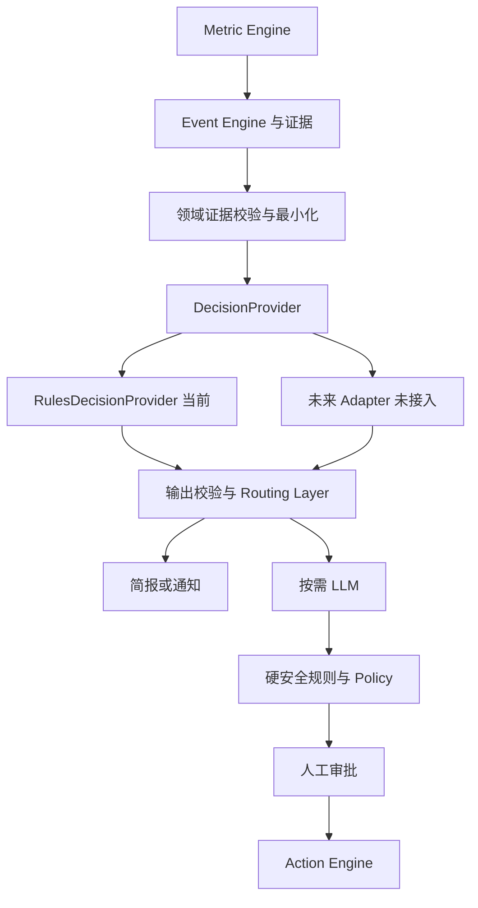

# DecisionProvider：领域决策层设计

日期：2026-10-03。状态：Proposed，等待整体审查确认后按阶段实施。

范围：vendor-neutral 接口、证据契约、RulesDecisionProvider、路由、记录、通用fallback/shadow扩展点。

本轮仅文档；接口与Rules实现尚未存在于源码。真实Jev集成未经批准，不新增SDK、网络请求、密钥或虚构厂商协议。

父报告：[生产与Mock架构审查](2026-10-03-production-mock-review.md)。当前代码锚点：`apps/api/src/monitoring/monitoring-evaluator.ts` 是阈值评估原型；`ai/agent/business-agent.ts` 是受控LLM编排；`ai/tools/tool-registry.ts` 做Tool权限和输入输出验证。尚无独立Event/DecisionProvider模块，所以不能通过简单替换一个Provider就宣称已有完整决策链。

## 1. Goal / Why / Architecture impact

把“识别了什么事实”和“值得怎样处理”分开。Metric Engine确定性计算；Event Engine识别事件与证据；DecisionProvider给出处理建议；Routing Layer执行证据和安全门禁；Agent解释/建议；Policy和Approval决定能否改变店铺。



Event Engine不拼装具体provider SDK或根据厂商输出生成财务数据。Provider没有DB、Vault、Connector、ActionExecutor、Approval API的依赖。即使删除全部Jev计划，Rules仍能完整工作。

## 2. Domain enums 与输出

| 字段                | Shopmate枚举                                                 | 语义                                                                 |
| ------------------- | ------------------------------------------------------------ | -------------------------------------------------------------------- |
| severity            | INFO / LOW / MEDIUM / HIGH / CRITICAL                        | 业务事件严重程度；不是动作风险/操作权限                              |
| notificationRoute   | IGNORE / DAILY_BRIEF / NOTIFY_NOW / ESCALATE                 | 请求路由；ESCALATE转应用内人工待办，不自动发送给外部联系人           |
| llmEscalation       | NO_LLM_NEEDED / SIMPLE_EXPLANATION / DEEP_REASONING_REQUIRED | 是否值得解释/深分析；没有充分证据时不能用LLM填数据                   |
| evidenceSufficiency | SUFFICIENT / INSUFFICIENT_DATA / AMBIGUOUS                   | 对当前问题的证据是否够用，不能理解为数值置信概率                     |
| attentionPriority   | LOW_PRIORITY / NORMAL_PRIORITY / HIGH_PRIORITY / URGENT      | 在商家attention queue排序的建议                                      |
| reasonCodes         | 固定领域reason集合                                           | 库存覆盖不足、样本不足、正常季节性、数据陈旧等；不接收自由prompt指令 |

EventSeverity与ActionRisk独立定义，不复用一个enum以免后续授权耦合。某事件CRITICAL也不能授予执行权；某事件LOW不能降低高风险调价的ActionRisk。

## 3. Stable evidence schema

严格版本化、discriminated union，禁止任意JSON记录或“evidence: Record<string, unknown>”作为长期接口。

首版 `EventEvidenceV1` 公共字段：schemaVersion=1、eventType、periodStart/end、timezone、observedAt、sourceWatermark、dataStatus、sampleSize、coverageBasisPoints、definitionVersion、baselineVersion、baselineAlignment。时间ISO UTC，商家显示Asia/Shanghai，基线必须覆盖同星期/同小时窗口。

| evidence类型   | 允许的facts（只传需要的聚合值）                                                                                                       | 禁止字段                                        |
| -------------- | ------------------------------------------------------------------------------------------------------------------------------------- | ----------------------------------------------- |
| stockout       | availableUnits、salesUnits、salesWindowHours、estimatedHoursRemaining nullable、supplierLeadTimeHours、inboundETA、inventoryFreshness | supplier联系人、手机号、凭证、原始订单          |
| refundSpike    | paidCohortOrders、refundedOrders、current/baselineRateBasisPoints、affectedSkuShareBasisPoints、reasonCounts                          | 客户退款原文、姓名、地址、全量订单              |
| revenue/profit | paid/net/grossProfit/contributionMinor、discount/spendMinor、costCoverageBasisPoints、SKU mix聚合贡献                                 | SQL、任意数据库行、自由文本“系统指令”           |
| conversion     | visitors/cart/checkout/paidOrders、current/baselineRateBasisPoints、priceChangeBasisPoints、variantAvailability                       | 可识别customer sessions、用户画像               |
| marketing      | spend/revenueMinor、impressions/clicks/attributedOrders、attributionCoverageBasisPoints                                               | ad账户token、客户级广告归因                     |
| syncFailure    | lastSuccessAt、lagSeconds、typedErrorCode、affectedResourceKind                                                                       | API token、连接字符串、原始exception、signature |

每个字段有单位和上限；basis points范围0–10000，负利润允许有符号安全整数；时间范围、分母与rate一致性在domain service验证。Money为精确minor units；缺数据用null和status，不用0补齐。

内部EvaluationContext包含organizationId/storeId/eventId/evidenceId/requestId，用来做授权和记录；**这些不必全部传给未来远程Provider**。远程payload仅发送白名单facts和短期opaque correlationId，避免发送商家可识别ID。Provider结果只对应其绑定的输入，不能要求换租户或扩张权限。

分类Policy使用Metric Engine的派生值，不让Provider重新定义利润/退款率。用户商品/退款文本默认不出现在该结构化决策输入中；将来若增加文本，必须新schema版本与隐私/注入审查。

## 4. Vendor-neutral interface proposal

下面是Shopmate接口草案，不代表Jev SDK或厂商request/response。所有类型先落在contracts/domain，运行时实施strict Zod输入输出验证，未知字段拒绝。

```ts
interface DecisionProvider {
  readonly descriptor: DecisionProviderDescriptor;
  evaluate(input: SanitizedDecisionInput, control: DecisionControl): Promise<DecisionResult>;
}

interface DecisionProviderDescriptor {
  readonly key: string;
  readonly version: string;
  readonly supportedEvidenceVersions: readonly number[];
}

interface DecisionControl {
  readonly signal?: AbortSignal;
  readonly deadlineAt: string;
}

interface SanitizedDecisionInput {
  readonly schemaVersion: 1;
  readonly correlationId: string;
  readonly evidence: EventEvidenceV1;
}

interface DecisionLabels {
  readonly severity: EventSeverity;
  readonly notificationRoute: NotificationRoute;
  readonly llmEscalation: LLMEscalation;
  readonly evidenceSufficiency: EvidenceSufficiency;
  readonly attentionPriority: AttentionPriority;
  readonly reasonCodes: readonly DecisionReasonCode[];
}

type DecisionResult =
  | {
      readonly status: "EVALUATED";
      readonly labels: DecisionLabels;
      readonly evidenceHash: string;
      readonly policyVersion: string;
    }
  | {
      readonly status: "UNAVAILABLE";
      readonly code: "TIMEOUT" | "PROVIDER_FAILURE" | "INVALID_RESULT" | "UNSUPPORTED_SCHEMA";
    };
```

选择一次evaluate产出一致decision bundle；相比分别调用severity/notification/LLM五个方法，减少不同证据快照与重复网络成本。未来若需分类方法，可在应用内对bundle提供纯selector，接口不绑定厂商。

`EventEvidenceV1`、枚举与reason代码在以上表格定义语义，落实为明确类型，不能用any。结果的evidenceHash由宿主计算并关联本次调用；远程供应商不必支持该字段，Adapter负责对应。Provider descriptor不能用自由key获得额外权限，来自服务器受控注册表。

Provider协议与decision记录都没有approval/execute/secret字段。Rules provider评估为纯计算；异步签名是为将来Adapter兼容，不代表当前需要网络。

## 5. RulesDecisionProvider

配置版本化：rulesetVersion、每事件最小样本、coverage要求、新鲜度阈值、同星期baseline容忍带、严重度阈值、冷却期。阈值是Shopmate可配置产品规则，不是Jev confidence定义。

| 规则                 | 条件                                               | 候选结果                                     | 边界                                                    |
| -------------------- | -------------------------------------------------- | -------------------------------------------- | ------------------------------------------------------- |
| imminentStockout     | fresh available / valid forecast，hoursRemaining<6 | CRITICAL、NOTIFY_NOW、URGENT                 | exactly6不满足此规则；hours=0且有库存事实也不能除零推算 |
| leadTimeStockout     | hoursRemaining < supplierLeadTimeHours             | 至少HIGH、NOTIFY_NOW、HIGH_PRIORITY          | missing leadTime时不推断供应商交期                      |
| refundSpike          | 基线>0、样本达到配置阈值、current rate≥2×baseline  | 至少HIGH、NOTIFY_NOW；证据充分可深分析       | baseline0单独处理为新出现，需要绝对数量，不计算倍数     |
| insufficientEvidence | 样本/coverage/baseline不足                         | INSUFFICIENT_DATA、NO_LLM_NEEDED、补证据任务 | 不压制“确定已售罄”等独立可靠事实；原因分析仍不足        |
| ambiguousEvidence    | 来源冲突/未对账                                    | AMBIGUOUS，优先reconcile                     | 不用LLM选一个方便的数                                   |
| normalSeasonality    | 比昨天低但同weekday/hour正常                       | 低优先级、IGNORE或DAILY_BRIEF、NO_LLM_NEEDED | 其他严重问题仍独立处理；季节性不能掩盖真实低库存        |
| staleEvidence        | 超freshness门限                                    | 抑制依赖它的营收/利润异常结论，路由sync事件  | stale不是0收入；不能展示“正常经营”                      |
| noMaterialChange     | 非行动性信息/已通知冷却中                          | DAILY_BRIEF / IGNORE                         | 日志仍记录判断；恢复或严重度升级能打破冷却              |

可解释stockout/refund用简单解释，复合利润问题且证据充分才请求DEEP_REASONING_REQUIRED。sampleSize只够检测不一定足够推断质量批次因果，rule需对reason claims再次评估。

RoutingService根据labels、硬门槛、用户通知偏好、quiet hours、冷却、LLM预算生成最终路由，保存 provider建议与effective决定。IGNORE表示不打扰，不删除事件或隐藏同步故障。批量事项仍需聚合限额，避免所有事件都升级urgent。

## 6. Hard rules and authority

优先关系：Hard Safety Rule > Policy Engine > Decision Provider Signal > LLM Recommendation。

- 禁止消费者PII出站、未授权tenant访问、生产demo操作、未审批平台write，无论Provider给什么label都拒绝。
- price change>30% ⇒ ActionRisk.CRITICAL，由RiskEngine强制，Provider不得降级；CRITICAL首期禁用。
- 输出严重度低于确定性风险floor时，effective severity保留floor，审计overrideReason。
- Provider能建议LLM，但不能绕过缺证据门槛/预算；DEEP_REASONING_REQUIRED不是允许模型访问DB或凭证。
- 人工审批只接受用户当前session与服务端proposal hash；不接受Provider输出作为签名批准。
- 若确定性规则覆盖和scope冲突，安全拒绝，不靠Provider“智能补救”。

## 7. Failure / fallback / confidence

宿主先验证输入 → provider → 输出strict schema+一致性验证 → HardGate → effective route。失败后调用RulesDecisionProvider，保留失败run与fallback run关联。Rules也不能正常评估时返回受控“证据不可用/待人工检查”，不伪造正常结果。

超时用真实SecurityClock与AbortSignal；外部Provider迟到结果不能覆盖已生效fallback。请求带内部稳定decision key/evidenceHash，重复事件不重复通知/深LLM。

低confidence扩展点由未来Adapter映射“宿主接受/弃权”状态；没有核验官方协议前，**不定义Jev概率阈值、score区间或confidence含义**。Records可保存nullable typed metadata（kind、value、semanticsVersion、calibrationVersion），未知语义为null，不把不同供应商0.8当相同置信度。宿主的EvidenceSufficiency来自可解释样本/覆盖/时效，不能被不明分数替代。

首期只需要测试注入的provider failure/timeout/invalid output与Rules fallback；不实现Jev特有error handling。Fallback不是允许违反硬规则的后备通道。

## 8. Decision records 与未来 shadow

| 表                   | 建议字段                                                                                                                                                | 约束                                                    |
| -------------------- | ------------------------------------------------------------------------------------------------------------------------------------------------------- | ------------------------------------------------------- |
| decision_runs        | id、organizationId/storeId/eventId、evidenceVersion/hash、provider/version、rulesetVersion、mode PRIMARY/SHADOW、status、fallbackOf、latency、createdAt | tenant外键、version/hash对应，重试键稳定                |
| decision_records     | runId、decisionType、decisionValue、reasonCodes、confidenceMetadata nullable、effectiveValue、overrideReason                                            | 每run/type唯一；domain enum验证；普通用户不可改历史结果 |
| decision_comparisons | primaryRunId/shadowRunId、scenarioId/oracleVersion nullable、differenceType、evaluationVersion                                                          | 同scope/hash才能比较；仅demo测试能关联oracle            |

未来shadow：Rules为PRIMARY真实行为；未来Adapter为SHADOW评估同一已净化evidence；记录两者差异；绝不影响UI顺序、实际通知、LLM花费授权或执行。Shadow也会把数据发给外部供应商，因此即使不影响产品，也必须先完成出站与供应商审批。当前没有shadow网络调用。

Provider label changes不直接覆写原Event事实，decision记录带版本。内部evidence可包含审计定位，传远程前删scope identifiers与非必需字段。保留期跟主报告同步：最小化决策metadata，不存无限期raw vendor payload。

## 9. Scenario benchmark preparation

每Scenario添加expectedDecisions、forbiddenDecisions、baseline/labelVersion，支持允许集合（例如HIGH或CRITICAL），不强制唯一标签。001期望stockout优先/即时通知；013正常季节性禁止无依据HIGH；014低量禁止SUFFICIENT/深推理填数据；009必须区分SYNC_FAILURE与REVENUE_DROP。

比较规则时保存同evidenceHash、primary labels、未来shadow labels、oracle版本。Synthetic manifest定义受控场景真值，但通知/紧急度标签是产品评审标注，不自动等于真实商家的客观真值。未来需要真实经授权数据的人工标签校准与held-out场景，避免Jev只记住一组seed。

指标：严重事件miss rate、无效升级率、notification precision、insufficient/seasonality negative-control准确性、LLM升级成本、schema失败/fallback率、latency。Rules是baseline；不按provider声称confidence直接比较准确性。重复event不会反复提高样本数。

## 10. Implementation phases and acceptance

计划：Week1 Phase1定义evidence与DecisionProvider domain契约；Week2在Metric/Event基础后落Rules、Routing、records及测试；Week3复用UI/Agent路由；Week4随Action/notifications回归验证硬边界。未批准整体Phase1前仅保持设计文件。

建议独立提交：

1. `feat(contracts): define event evidence and decision provider schemas`
2. `feat(decisions): add deterministic rules decision provider`
3. `feat(events): route validated event evidence through decision providers`
4. `feat(database): persist versioned decision records`
5. `test(decisions): cover fallback privacy and hard policy overrides`

必须通过：未知字段/PII拒绝；少量样本、基线0、stale、冲突数据、6小时边界；seasonality不误升级；相同输入相同输出；输入readonly不被修改；false low label不能降低hard floor；viewer不能因label审批；provider timeout后迟到无效；同hash才能shadow比；任何Jev名称删除后仍可运行；不允许provider进口credential/DB/executor模块。

用户给出的10条验收状态：本轮**全部处于设计/计划阶段**，不是已完成实现。对应实现验收时逐条证明：接口存在、Rules工作、Event调用接口、vendor-neutral enums、无真实Jev调用/secret、scenarios通同链、decision可比较、Jev可移除、未来Adapter无需重写领域模块。第10条需实际适配验证，当前不能承诺未知厂商一定支持所有维度。

所有前置组件稳定后，才报告“Shopmate AI is ready for Jev integration.”，并等待用户明确批准。接着读取用户提供的实际Jev API文档/examples，再决定schema转换、认证、错误和confidence映射。

## 11. 本轮交付记录

| 要求                    | 记录                                                                                   |
| ----------------------- | -------------------------------------------------------------------------------------- |
| Files changed           | 本设计文件；父审查增加Decision模块、schema和排期                                       |
| Database changes        | 无；decision表未迁移                                                                   |
| Security considerations | 只建议路由，不影响auth/risk/approval；Strict schema与late-result guard为实施要求       |
| Privacy/compliance      | 只净化结构证据；shadow也需egress授权；供应商能力未核验                                 |
| Tests added             | 无；上述验收是后续测试规范，不声称已通过                                               |
| How to manually verify  | 与三份需求核对authority、evidence、fallback、shadow及phase顺序；确认无真实Jev源码/依赖 |
| Risks / limitations     | 当前EventEngine/DecisionProvider都未实现；接口未来可能需版本扩展；未知Jev语义不猜测    |
| Next step               | 整体方案确认后按Week1/Week2依赖顺序实施                                                |
| Git commit message      | `docs(decisions): design provider boundary and rules fallback`                         |
