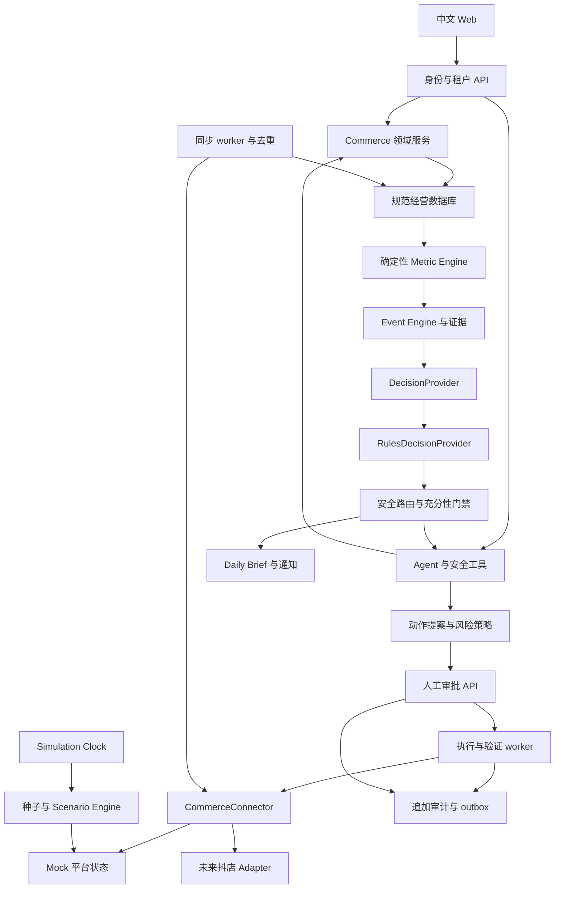

# Shopmate AI：生产架构与 Mock Commerce Environment 审查

日期：2026-10-03（用户时区 Pacific/Auckland）  
状态：**Proposed / 等待产品负责人确认，尚未开始 Phase 1**  
代码基线：`af4f96d`，当前分支 `feat/assistant-workspace`。

本报告覆盖三份需求：生产 SaaS 架构审查、最新优先级的 Mock Commerce Environment、Jev Decision Layer。当前不调用抖店或 Jev API，不接真实消费者数据。DecisionProvider 与 RulesDecisionProvider 纳入前置架构及获批后的实施范围，真实 Jev Adapter 需要未来单独批准。用户已确认：当前只用合成经营数据；演示环境可能公网开放；真实商家数据接入前默认中国大陆部署、跨境传输关闭。这里描述的目标能力、数据库及接口均为提案，不能理解为已实现。

**结论：保留 Next.js + NestJS + PostgreSQL + Prisma + 共享 Zod 契约；从现有分析助手渐进升级为模块化经营 Agent。第一项编码工作是租户领域与 Connector 契约，不是重新做看板，也不是先堆模拟数据。**

四周目标是能验证的 Mock 经营闭环，不是完整生产 SaaS 上线。真实平台执行、生产身份上线、法务验收与恢复演练有独立发布门禁。

## A. 当前架构与代码证据

当前运行链路：Next.js 同源 `/api` 转发 → NestJS 全局 Demo 会话 Guard → Controller / Service → Prisma Repository → PostgreSQL。AI 经过 Provider、BusinessAgent 和 ToolRegistry；部分 Tool 通过分析服务，一部分通过受约束的 StoreSalesReader 读取数据库。没有发现通用 SQL Agent 工具。

| 领域         | 实际存在                                                                                 | 证据与判断                                                                                                                                                 |
| ------------ | ---------------------------------------------------------------------------------------- | ---------------------------------------------------------------------------------------------------------------------------------------------------------- |
| 工作区       | pnpm monorepo：Web、API、contracts、database                                             | 根 `package.json`、`pnpm-workspace.yaml`；无需换框架                                                                                                       |
| Web          | Next.js 16.3.3 / React 19.2.8，中文看板、组件布局、主题、助手工作区、通知                | `apps/web/package.json`；`src/app/dashboard.tsx`、`assistant/`；已有加载、空、错误状态                                                                     |
| API          | NestJS 12.0.1；版本 `/api/v1`；全局 DTO 白名单与未知字段拒绝                             | `apps/api/src/app.config.ts`、`app.module.ts`                                                                                                              |
| 身份         | 固定环境变量 Demo 账户，HMAC 签名带期限 Cookie                                           | `auth/demo-auth.service.ts`、`session/demo-session.ts`；不是密码哈希用户系统                                                                               |
| 商家隔离     | AuthContext 带 merchantId，Guard 拒绝顶层 merchantId 注入，多处 Repository 带 merchantId | `auth/access/merchant-scope.guard.ts`、`products/product.repository.ts`；已有防线，但不是完整多租户授权                                                    |
| 数据库       | 9 个模型，4 个迁移目录                                                                   | `packages/database/prisma/schema.prisma`：Merchant、Product、Sku、Store、Order、OrderItem、UserDashboardLayout、UserMonitoringRule、MonitoringNotification |
| 分析         | 整数分计算、销售汇总、趋势、热销、库存风险、中国自然日窗口                               | `analytics/metric-rules.ts`、`analytics-window.ts`；应复用纯函数                                                                                           |
| Agent        | Provider 抽象、工具白名单、权限、输入输出验证、调用限额、数字与日期校验                  | `packages/contracts/src/ai/llm-provider.ts`、`ai/tools/tool-registry.ts`、`ai/agent/business-agent.ts`                                                     |
| 流式助手     | NDJSON HTTP 响应、断连取消、同身份运行互斥、内存 requestId 去重                          | `ai/chat/assistant-run.controller.ts`；不是持久任务或跨进程幂等                                                                                            |
| 监听         | 销售/库存阈值规则、通知 fingerprint 去重、nextRunAt                                      | `monitoring/`；由接口执行/同步规则，模块中没有独立调度 worker                                                                                              |
| 小型确认原型 | 库存预警阈值 PREVIEW / CONFIRM / CANCEL，身份绑定、过期、乐观并发                        | `ai/tools/inventory-alert-update.tool.ts` 与 repository；只修改内部预警值，当前 AiModule 未注册该 Tool，不是平台补货或价格操作                             |
| Mock 数据    | 固定商品/订单 Seed；另有确定性的丰富分析 Seed                                            | `packages/database/src/analytics-demo-data.ts`：2 个商家，每个 6 个网点、30 商品、60 SKU、3,000 订单，覆盖约 180 日                                        |
| Mock LLM     | 根据意图及已验证 Tool 结果生成测试输出                                                   | `ai/providers/mock-llm.provider.ts`；适合离线测试，不构成真实经营推理验收                                                                                  |
| CI           | secret scan、format、lint、typecheck、test、build                                        | `.github/workflows/ci.yml`；没有数据库服务、依赖漏洞扫描或强制真实 DB 集成检查                                                                             |
| 部署         | main push 触发 SSH 拉代码、构建、PM2 restart                                             | `.github/workflows/deploy.yml`；独立于质量 workflow，未声明等待 CI、staging、production environment 人工门禁、迁移与部署后 smoke                           |

README 将当前产品定义为 Demo；这与代码一致。多平台名称只是合成网点标签，不能作为平台 Connector 已接通的证据。

## B. 可复用组件

| 保留内容                                | 复用方式                                                  | 需补充                                                |
| --------------------------------------- | --------------------------------------------------------- | ----------------------------------------------------- |
| monorepo 与 NestJS 模块分层             | 在原模块旁新增 Tenant、Integrations、Sync、Actions、Audit | 不拆 20 个服务，不另起 Python API                     |
| Zod strict schema 和 API versioning     | 扩展共享领域 DTO、分页、错误、证据契约                    | OpenAPI 生成/校验、统一 requestId 错误 envelope       |
| merchantId 查询习惯                     | 渐进迁移到 organizationId / storeId，兼容旧接口           | membership 校验、权限检查、复合外键、RLS              |
| 金额、窗口、趋势纯函数                  | 成为 Metric Engine 核心计算库                             | 支付/退款/成本历史、利润口径、freshness、样本量       |
| 库存风险与产品表现                      | 作为事件检测输入                                          | 历史库存、预留/在途、供应商交期、缺成本警告           |
| ToolRegistry / Provider / BusinessAgent | 保留受控工具调用；新增领域工具                            | Evidence ID 绑定、区域策略、持久 AgentRun 和运行预算  |
| NDJSON 与助手 UI                        | 保留交互、取消、工具进度、证据展现基础                    | 后端 run 状态、跨实例租户限额、会话保留策略           |
| 通知中心与 fingerprint                  | 接入 EventEngine 的状态变化                               | 冷却、合并、恢复通知、偏好与异步配送                  |
| 确认原型                                | 复用过期、actor binding、expected version 的思路          | 独立 Actions API 与数据库状态机；确认令牌不暴露给 LLM |
| 演示 Seed 的 dry run、命名空间冲突检查  | 复用命令与测试思想                                        | 统一环境门禁、可重置 session、seed/version/clock      |
| 响应式 UI 与现有回归测试                | 保留组件，不整体重画                                      | 概览优先重要事件、待审批、少量 KPI；375px 验收        |

## C. 差距分析与必须重构的边界

P0 指进入任何真实商家数据/平台写入前必须完成的门禁；不表示当前已确认被攻击。

| 优先级 | 差距                                                           | 具体影响与处理                                                                                                                                           |
| ------ | -------------------------------------------------------------- | -------------------------------------------------------------------------------------------------------------------------------------------------------- |
| P0     | Demo 身份，不支持 Organization / Membership / Workspace / RBAC | 登录给出全部 AuthPermission；不能拿来实现 OWNER / VIEWER。引入可吊销服务端 session、成员关系和资源授权                                                   |
| P0     | 登录缺少仓库可见的暴力破解限流，退出只清 Cookie                | 拷贝的签名 token 在到期前仍可验证；生产需吊销、轮换、会话设备管理与短期单次重置 token                                                                    |
| P0     | 身份认证不等于操作授权                                         | ToolRegistry 有 permission 校验，但商品 Service/Controller 未见 products:read 检查；统一后端 Policy，防止绕过 Agent 直调 API                             |
| P0     | 关联完整性不完整                                               | Order→Store 有 merchant 复合外键；Sku→Product、OrderItem→Order/Sku 缺同租户复合关联，OrderItem 没 ownership 列；补 schema 约束并证明跨租户关联被 DB 拒绝 |
| P0     | 无正式 Action / Approval / Execution / Audit 链                | 内存确认不能跨重启恢复，内部阈值修改不是平台操作；新增独立执行服务和持久状态                                                                             |
| P0     | Demo Seed 防护不一致                                           | analytics Seed 有 dry run 和 opt-in，但不硬拒绝 production；demo:init / seed / order-seed 没有同等环境限制。统一失败关闭门禁，禁止生产演示写入           |
| P0     | 生产部署没与质量门禁串联                                       | 不能把 main push 等同通过验证；加 staging、受保护环境人工批准、不可变构建、迁移策略、回滚与恢复演练                                                      |
| P0     | 隐私、外部模型区域、断开/删除没有完整实现                      | 不能仅因供应商品牌或 API 使用 HTTPS 就保证数据留在境内；新增 egress policy、处理者清单、删除任务、停止采集                                               |
| P1     | 没有 CommerceConnector、Sync、Webhook、Cursor、Outbox          | Seed 直接写 Shopmate DB，无法验证平台失效和最终一致性；搭建 source → adapter → normalization → DB 同步链                                                 |
| P1     | 订单状态/财务口径不足                                          | 旧销售 reader 排除 CANCELLED，可能计入 PENDING；StoreSalesReader 只选 PAID。统一支付事实口径；不要把 PENDING 计入已支付销售额                            |
| P1     | SKU 成本快照不足                                               | 当前成本是必填当前值，不支持缺成本或订单历史成本；后续改成本不应重写历史毛利                                                                             |
| P1     | 看板部分查询按请求装载原始订单                                 | SalesQueryRepository 无聚合表；StoreSalesReader 到 20,000 行拒绝；多次服务读取也可能获取不同快照。用预聚合与单一计算批次                                 |
| P1     | 时钟分散                                                       | Agent、运行互斥、监听、日期默认等有 wall clock；业务模拟统一 Clock，身份/安全 TTL 保留真实时钟                                                           |
| P1     | AI 数字校验不是语义证据验证                                    | 数字在结果里出现，不代表归属商品/日期/单位正确；将 claim 绑定 metric/evidence ID，派生计算仍由服务完成                                                   |
| P1     | Prompt/业务内容泄露防线不足                                    | 系统提示区分不可信 Tool/历史，但缺集中最小化与脱敏；Agent stderr 数字诊断可能包含商业数据，需收紧                                                        |
| P1     | 监听不是持续 Event Engine                                      | 缺 baseline、事件生命周期、冷却、充分证据门槛、独立 worker；页面无人打开时也要可监控                                                                     |
| P2     | UI 重心仍是看板编辑和主题                                      | 复用界面，逐步把重要事件、待审批置顶；不要继续把布局花样当核心经营价值                                                                                   |

不建议改为 FastAPI、微服务、向量数据库、RAG 或自训模型。现阶段没有证据证明这些成本能解决上述问题。

## D. 目标领域模型与多租户架构

### D1. 聚合与身份层级

`User → OrganizationMember → Organization → Workspace → Store → PlatformConnection`。

- User 是全球身份，可加入多个组织，不把 userId 直接当 tenantId。
- Organization 是租户边界。Workspace 是组织内协作/授权范围，不是独立跨租户容器。
- Store 属于一个 Workspace 和 Organization；先支持每个店铺一条有效运营连接，历史连接可保留。
- Product / Variant / SKU 是规范化目录；StoreListing / PlatformSku 表示一个店铺的平台商品/SKU 映射。不要把“商品”与“平台 listing”揉成一个实体。
- Order / OrderItem / PaymentFacts / Refund / AfterSales 保留来源与历史；customerSyntheticId 仅为演示关联，不生成人名、手机、地址或身份证。
- InventoryLocation / Ledger / Snapshot 记录库存变化；供货的 PurchaseOrder / InboundShipment 与库存更新是不同业务动作。
- MetricDefinition / MetricSnapshot / Event / Evidence / DailyBrief 负责可复算经营结论。
- AgentRun / ToolCall / ActionProposal / Approval / Execution / AuditEntry 负责决策闭环。
- DemoSession / ScenarioRun / FailureRule 仅属于隔离演示管理模块。

### D2. ownership 与授权

所有租户业务表显式 organizationId；店铺业务表再带 storeId；跨店目录以 organizationId 为边界。全局 users、静态 metricDefinitions 不是租户业务表，单独授权管理。

HTTP：验证 session → 从 membership 校验所选 organization/workspace/store → 构造不可由 body 指定的 TenantContext → `authorize(subject, resource, action, tenant)` → 领域服务。前端切换组织只是选择请求，不能建立权限。

Worker：job 中的 organizationId/storeId 是定位信息，不是授权凭证；重新校验 Store 状态、Connection 代次、受限 service principal。不得使用全组织通用“管理员” context。

缓存键、分页 cursor、导出对象存储路径、运行去重键、stream identity、Agent memory 都包含组织/店铺与环境。客户端历史不作为授权或已验证事实。

| Role     | 首期默认权限                                                           |
| -------- | ---------------------------------------------------------------------- |
| OWNER    | 组织管理、成员、连接、所有获准店铺操作；危险操作仍需审批               |
| ADMIN    | 工作区管理、连接与通常审批；不能绕过 critical 策略                     |
| OPERATOR | 店铺经营读写提案，审批 MEDIUM 及以下可配置；默认不批准 HIGH / CRITICAL |
| ANALYST  | 经营读取、报告、提案；不能批准或执行                                   |
| VIEWER   | 被授权工作区的只读信息；不能创建/批准店铺写动作                        |

权限在后端统一判定，Role 只是权限模板。高风险动作可要求提案人与审批人分离；批量删除、授权改变、消费者数据导出首期禁用。

### D3. PostgreSQL 隔离

Application scoping + 同租户复合外键 + RLS。每张租户表有 `(organization_id, id)` 唯一键；子表使用 `(organization_id, parent_id)` 外键。店铺业务进一步约束 `(organization_id, store_id, entity_id)`，防止同组织跨店误关联。

RLS 在迁移中定义 USING 和 WITH CHECK；应用角色不是 superuser、不是 BYPASSRLS、不是 schema owner。使用事务内 parameterized `set_config(..., true)` 设置验证过的 tenant scope，缺 scope 拒绝；后续 Prisma 查询必须使用同一个 transaction client。连接池不得遗留 session 级租户变量。数据库迁移 owner 与应用角色分离。

PostgreSQL 的 superuser/BYPASSRLS 绕过行策略，表 owner 默认也绕过，因此不能只写 CREATE POLICY 就宣称隔离完成。参见 [PostgreSQL 行安全官方说明](https://www.postgresql.org/docs/17/ddl-rowsecurity.html)。

### D4. 渐进迁移

1. 新增组织、成员、工作区、连接和规范字段；保留 Merchant 与旧 DTO。
2. 建立 legacyMerchantId → organizationId 映射，明确产品/订单店铺归属；旧 order.storeId=null 不凭空指派真实平台，标记 legacy/unassigned。
3. 隔离数据库回填，新增同租户外键与索引；检测既有坏关联，失败时输出脱敏冲突摘要。
4. 兼容 reader 从新领域模型输出旧看板 DTO；以实际查询计划检查性能。
5. 新入口、worker、Tools 均完成隔离测试后切换读路径，之后移除旧字段。不得现在直接删 Merchant 或重建生产表。

## E. CommerceConnector 提案

业务读取使用规范化 DB；Connector 用于采集和平台执行，不是每次 Dashboard load 都请求平台。注册表依赖 `connectorKey` 和 capability，不到处判断 platform 是否为 MOCK / DOUYIN。

ConnectorFactory 在服务端验证 TenantContext、Store、Connection 后生成**绑定单一连接**的实例。Agent 不接触 Factory、token、secretRef 或平台调用对象。凭证解析与刷新只在 Integrations 模块内完成；授权服务与经营数据接口分开。

下面是接口设计草案，不是新增源码。DTO 名称见下表，落地时每个输入/输出都有 strict Zod schema；金额为校验过的安全整数分，JSON boundary 不使用 bigint 或浮点金额。

```ts
interface CommerceConnector {
  readonly capabilities: ConnectorCapabilities;
  getStore(options: ReadOptions): Promise<ConnectorStore>;
  listProducts(query: SyncPageQuery): Promise<ConnectorPage<ConnectorProduct>>;
  getProduct(ref: ExternalProductRef, options: ReadOptions): Promise<ConnectorProduct>;
  listOrders(query: SyncPageQuery): Promise<ConnectorPage<ConnectorOrder>>;
  getOrder(ref: ExternalOrderRef, options: ReadOptions): Promise<ConnectorOrder>;
  listRefunds(query: SyncPageQuery): Promise<ConnectorPage<ConnectorRefund>>;
  getInventory(query: InventoryQuery): Promise<ConnectorPage<ConnectorInventory>>;
  getMarketingMetrics(query: MarketingQuery): Promise<ConnectorPage<ConnectorCampaignMetric>>;
  updatePrice(command: SetPriceCommand): Promise<WriteReceipt>;
  updateInventory(command: SetInventoryCommand): Promise<WriteReceipt>;
  createProduct(command: CreateProductCommand): Promise<WriteReceipt>;
  updateProduct(command: UpdateProductCommand): Promise<WriteReceipt>;
  verifyAction(query: VerifyActionQuery): Promise<VerificationResult>;
}

interface ConnectorCapabilities {
  readonly readOrders: boolean;
  readonly readRefunds: boolean;
  readonly readMarketing: boolean;
  readonly writePrice: boolean;
  readonly writeInventory: boolean;
  readonly publishProduct: boolean;
  readonly webhookMode: "NONE" | "SUPPORTED";
  readonly idempotencyMode: "NATIVE" | "EMULATED" | "UNSUPPORTED";
}

interface SyncPageQuery {
  readonly cursor?: string;
  readonly since?: string;
  readonly until: string;
  readonly limit: number;
  readonly signal?: AbortSignal;
}

interface ConnectorPage<T> {
  readonly items: readonly T[];
  readonly nextCursor: string | null;
  readonly observedAt: string;
  readonly sourceWatermark: string | null;
}

interface WriteReceipt {
  readonly executionId: string;
  readonly platformRequestId: string | null;
  readonly outcome: "ACCEPTED" | "REJECTED" | "UNKNOWN";
  readonly receivedAt: string;
}

type VerificationResult =
  | { readonly status: "VERIFIED"; readonly snapshot: VerifiedActionSnapshot }
  | { readonly status: "PENDING"; readonly retryAfterMs: number }
  | { readonly status: "MISMATCH"; readonly snapshot: VerifiedActionSnapshot }
  | { readonly status: "UNAVAILABLE"; readonly reason: ConnectorFailureCode };
```

| 契约类型                    | 必需字段/语义                                                                                                       |
| --------------------------- | ------------------------------------------------------------------------------------------------------------------- |
| ReadOptions                 | requestId、signal；限时读取，scope 已绑定实例                                                                       |
| External\*Ref               | 外部商品/订单/SKU ID，仅由校验过的内部映射解析，不能作为 Shopmate 主键                                              |
| Connector\*                 | 平台无关规范 DTO、sourceVersion/sourceUpdatedAt、currency、质量状态；不含凭证或客户 PII                             |
| SetPriceCommand             | executionId、idempotencyKey、外部 SKU、expectedVersion/oldPriceMinor、newPriceMinor、CNY                            |
| SetInventoryCommand         | executionId、idempotencyKey、location/SKU、expectedVersion、oldAvailable、targetAvailable；禁止把相对 +100 盲目重试 |
| Create/UpdateProductCommand | 严格 listing 输入、平台必需字段校验结果、executionId、idempotencyKey、expectedVersion（更新）                       |
| VerifyActionQuery           | executionId、预期状态、外部资源定位、signal；独立 read，不只相信 write response                                     |
| VerifiedActionSnapshot      | 实际值、expected value、读取时间、source version、平台资源 ID；审计保存脱敏结构                                     |
| ConnectorFailureCode        | TIMEOUT / RATE_LIMIT / AUTH_EXPIRED / PERMISSION_DENIED / TEMPORARY / CONFLICT / INVALID_RESPONSE / UNSUPPORTED     |

营销和退款能力可为 false；“不支持/未授权”与“返回零”是不同结果。缺原生 cursor 的平台，由 Adapter 封装分页/时间窗口并用 overlap + 去重，不承诺所有平台有统一分页或原生幂等。

授权接口为独立 `ConnectionAuthorizationService`：beginAuthorization、completeAuthorization、refreshAuthorization、revokeAuthorization。只返回授权状态/能力，token 放 Vault；Mock 也实现授权有效/失效状态。网络错误是否可重试和写结果是否未知必须分开。

## F. MockCommerceConnector 与目标系统结构



### F1. source of truth 与 persistence

Mock 平台拥有自己的 catalog、订单、退款、库存 ledger、marketing、故障计划、命令去重和待生效写入。这不是 Shopmate 的 normalized tables。

第一版可在**独立演示数据库的独立 schema** `mock_platform` 存储源状态，避免引入 Mock HTTP 服务；源数据 role 与 app role 分离，Connector 拿限定 repository，普通领域 reader 不能导入 Mock repository。迁移到真实 Adapter 时，领域层仍只读取规范 DB。

Mock 写入首先提交平台状态；Sync 后规范 DB 更新。价格验证直接调用 Connector read，必要时等延迟一致性窗口。UI 同时显示 execution 状态和经营数据同步新鲜度，不能把尚未回读的本地状态当成功。

Mock 命令使用 `(demoSessionId, connectionId, idempotencyKey)` 唯一键和 payloadHash；同 key 同 payload 返回原 receipt，同 key 不同 payload 冲突。执行记录和平台 mutation 在同事务提交，读回可延迟，receipt 可被故障规则丢失。

### F2. 生成器与场景

`GeneratorConfig → Seeded PRNG → Profile Dynamics → Timestamped Business Events → Platform projections → Connector → Sync → Normalized DB`。

- 配置含 seed、generatorVersion、profile、UTC start/end、商家时区、商品/SKU数、订单量、增长、退款基线、广告预算、品类。
- 固定 seed + version + config + clock 输出相同 dataset hash。各模块/实体派生独立 RNG stream，翻页或增加商品不应改变所有既有订单。
- 源事件至少有 sales、payment、reservation、ship、cancel、refund、return、restock、price/discount、campaign、supplier delay。
- `expected_events` / `expected_agent_reasoning` 只用于 Scenario 的测试 oracle；**禁止直接注入 EventEngine 或作为 Agent 事实输入**。
- Agent 解释坏批次只能得到退款、批次等已同步证据；没有足够证据时说“集中在某 SKU，可能与质量有关”，不能把模拟器隐藏真因当已知。
- Scenario 有 PREPARED / RUNNING / COMPLETED，组合场景以优先级/冲突规则合成，不静默覆盖其他场景。

### F3. Clock

- RealClock：正常业务时间。
- SimulationClock：按 DemoSession 持久 now/revision，支持 advance 6h / 1d，业务域与历史生成使用它。
- SecurityClock：session、MFA、审批过期、签名重放窗口、worker lease 使用真实时间。模拟快进不能续期 token 或绕过审批。
- 单次快进批量 replay 事件与计算任务，记录 clock revision、最后完成 watermark；未完成时显示推进中，不宣称已同步。
- 场景“10 点正常，14 点退款异常”依赖其已生成/已观测数据，不能在 10 点提前泄露未来订单。

### F4. Demo 隔离与管理

`APP_ENV=demo` + `ENABLE_DEMO_MODE=true` + 数据库 environment marker + `demo:manage` 后端权限 + demo tenant 标记共同放行。production 无论 flag 如何都拒绝，管理 API 不注册或统一拒绝。普通真实商家不能靠 URL 或 body 打开演示控制。

控制：reset demo、load profile、load scenario、advance timeline、inject failure、reset actions。Reset 有二次确认，只允许指定演示 session；停止其 jobs，增加 generation，旧 jobs/cursors 作废。禁止全库 truncate 或重置真实租户。

拟新增命令（当前不存在）：`pnpm demo:seed --profile growing --seed 42 --as-of ...`、`demo:reset --session ...`、`demo:scenarios`；默认 dry run。`NODE_ENV` 不是唯一识别环境的依据，因为演示构建也可能是 production build。

### F5. 故障注入

| 故障                             | 可重复控制                        | 必须观察到的行为                                            |
| -------------------------------- | --------------------------------- | ----------------------------------------------------------- |
| timeout / temporary error        | 指定 operation、attempt、时间窗口 | 只读安全重试；写未知结果转 verification                     |
| rate limit 5min                  | 平台时钟窗口 + retryAfter         | worker 延后，带 jitter/backoff；不忙循环                    |
| expired token                    | 连接 authorization state          | 阻止读取/执行，要求重授权，不自动无限刷新                   |
| permission denied                | capability/权限拒绝               | 阻止提案或执行，区分无权限与空数据                          |
| delayed consistency              | 写入即时提交，read 延迟可见       | action 保持 EXECUTING / verification PENDING                |
| write success + response timeout | 提交后丢 receipt                  | 幂等 lookup/read-before-retry，不重复库存调整               |
| partial success                  | 一批子项分别提交/失败             | 子执行各自状态，父操作 PARTIAL 结果，未全部验证不可整体成功 |
| malformed response               | 缺字段、类型错误、重复 externalId | schema 拒绝/隔离坏记录，质量告警，cursor 不跨过未处理失败   |

Batch 首期 API 不开放；设计保留子执行以供后续。后台用真实调度时间控制重试，注入的平台故障持续期可选模拟时间；规则明确 time basis，测试避免混用。

## G. 完整 Mock 数据集设计

### G1. 四种店铺画像与体量

首期每店 60 商品、180 SKU（满足 50–100 / 100–300 目标），四店共 240 商品、720 SKU；SKU 含颜色/规格、不同成本、交期与毛利。组织 A 管 growing + problematic 两店，组织 B 管 mature + new，两边至少两个角色，用于既有同租户多店及跨租户测试。

| Store         | 历史与销量                                     | 业务动力与场景                                      |
| ------------- | ---------------------------------------------- | --------------------------------------------------- |
| A growing     | 180 日，当前 100–300 单/日，历史由较低销量增长 | 3C 配件、爆款、广告增长、周五晚/周末较强、部分缺货  |
| B problematic | 180 日，约 100–180 单/日                       | 收入表面增长，折扣/低毛利 SKU/广告/退款拖累利润     |
| C mature      | 180 日，约 80–120 单/日                        | 同星期稳定、低退款、正常库存；用于误报控制          |
| D new         | 店铺真实模拟开业仅 14 日，2–10 单/日           | 样本不足、冷启动、成本缺失；绝不补出 180 日虚假店史 |

演示环境覆盖至少 180 天，但 D 店保留真实冷启动语义。365 天作为配置选项，在分页、生成耗时、DB 聚合基准合格后启用。预计总订单约数万至十万，体量随配置变化；性能数字必须跑基准后填，不提前承诺。

### G2. 商品、SKU 与来源

品类：手机壳、充电器、充电宝、键鼠、耳机、钢化膜、USB Hub、数据线、支架。商品保存 public title、category、synthetic brand、status、launchAt；SKU 保存 variant attributes、sale/original/cost minor、currency、safetyStock、leadTimeDays、weightGrams、status。

每个 shop listing 有独立 external_product_id / external_sku_id，和 internal ID 映射。SKU 价格独立于 Product 展示价；成本随 effectiveFrom 变化，交易行冻结当时成本，未知成本保存 null，不用 0 填补。

### G3. 因果顺序与约束

广告 spend → impressions/clicks → visitor session → 漏斗 → conversion → 库存可售约束 → 订单 → 付款 → 预留/履约 → 售后/退款。小时权重决定日内节奏；week-of-week、周末、发薪日、促销、launch ramp 决定需求。商品 price elasticity、热门变体不可售和坏评价影响转换，不是独立随机抽样每张表。

订单状态：PENDING、PAID、SHIPPED、COMPLETED、CANCELLED、PARTIALLY_REFUNDED、REFUNDED。支付前取消释放 reservation，已发货不能按“未支付取消”返库。partial refund <= 已付且每笔退款不重复；退款到账与货物退回/质检入库是不同事件。

库存定义：available = onHand - reserved - quarantine；inbound 独立，不算即时可售；任意项非负。Ledger 的 restock、reserve、release、ship、accepted return、adjustment 带唯一 source event。日/小时 snapshot 可从 ledger 重建；缺货导致未转化的潜在需求，不生成无库存已履约订单。

支付/金额校验：grossMerchandise = Σ(unitPrice × qty)，discount 分摊守恒；paid = grossMerchandise - discount + customerShipping；refund 累计不超过 paid。履约运费、平台/支付手续费、广告归因独立事实；统一 rounding policy，余数按稳定顺序分配，禁止逐行舍入导致总账不平。

营销至少四类 campaign：健康、high spend low ROAS、逐步衰退、小预算高效率。views ≥ addToCart ≥ checkout ≥ paidOrders 用一致 session/funnel 定义；同一订单 primary attribution 仅一次， unattributed 单独保留。CTR=clicks/impressions，CPC=spend/clicks，CVR 使用明确分母，ROAS=attributedPaidRevenue/spend；零分母显示 unavailable。

### G4. 财务定义

以下是产品经营口径，不是会计收入确认/税务口径；商家结算对账能力另设验证。

| 指标                  | 首期定义                                                               | 不确定性处理                                              |
| --------------------- | ---------------------------------------------------------------------- | --------------------------------------------------------- |
| GMV                   | 时段内已支付商品原价总额（折扣前，取消/未付不计）                      | 清楚区别净实收；不沿用现有模糊 sales 名称                 |
| Paid revenue          | 时段内支付事实的商品折后额 + 买家运费                                  | 订单后续退款不抹掉原支付事实                              |
| Net revenue           | 时段收款 - 时段实际退款                                                | 同时支持按订单 cohort 计算退款，不混用两种窗口            |
| Gross profit          | 净商品收入 - 冻结的已确认/预计 COGS，退货按明确成本冲回规则            | 缺成本则 ESTIMATED，并披露覆盖率；不生成 exact 值         |
| Contribution          | gross profit + 净买家运费 - 履约运费 - 平台费 - 支付费 - 广告/促销分摊 | 折扣已减少收入，不能再重复扣一次                          |
| Estimated net profit  | contribution - 已配置的其他经营费用                                    | 未知固定费用说明不含，不能称真实净利润                    |
| Refund rate           | 指定支付订单 cohort 的发生退款订单数 / paid orders                     | 金额退款率另一个 metric；成熟度/样本数明确                |
| Inventory days / risk | available / 预测日销量；交期 + safety buffer 比较                      | 零销量 unavailable；低样本 insufficient；供应延期进入预测 |

MetricSnapshot 必含 definitionVersion、periodStart/end、timezone、currency、sourceWatermark、computedAt、sampleSize、coverage、status（VERIFIED / ESTIMATED / INSUFFICIENT / STALE / UNAVAILABLE）、evidence IDs。未同步不代表销售为 0；比较部分日与同截止时间基线，不能拿半天比较完整昨天。

### G5. 数据质量与验收

缺成本、缺 category、坏来源重复 ID、晚到订单、缺营销归因、库存陈旧、商品名称变化各有注入配置和 DataQualityIssue。单条坏记录可隔离但不能静默丢弃；sync job 输出成功/隔离计数和 cursor 安全位置。

验收：dataset hash 复现；金额/退款/库存守恒；时间状态正确；source 与 normalized upsert 数一致；分页无重复/遗漏；新店明确 insufficient；同星期季节性不误报；导出不含 PII；advance 后不暴露未来数据；手动动作不被下次生成器无声覆盖。

## H. 场景目录与 Event Engine

Scenario manifest 字段：scenarioId、version、name、description、startTime/endTime、affectedEntities、seed、clockRevision、sourceMutations、expectedEvents、forbiddenEvents、expectedEvidence、expectedAgentReasoning、expectedDecisions。所有 expected 字段只供测试与未来 provider benchmark，运行时 DecisionProvider/Agent 不得读测试答案。

| ID  | 场景                                        | 预期检测/证据                                          | 重要反例或验收                                |
| --- | ------------------------------------------- | ------------------------------------------------------ | --------------------------------------------- |
| 001 | 快销 SKU 临近售罄                           | STOCKOUT_RISK；available、销售速度、交期               | 充足库存 SKU 不一起告警                       |
| 002 | 充电器坏批次，Day3 开始退款，Day5 约基线3倍 | REFUND_SPIKE；SKU/批次集中、退款原因、样本             | 区分 store-wide；隐藏 batch 真因不得直接喂 AI |
| 003 | 营收上升利润下降                            | PROFIT_MARGIN_DROP；折扣、spend、SKU mix 贡献分解      | 分解由确定性服务算，禁止 LLM 算贡献           |
| 004 | 广告 ROAS 崩塌                              | ROAS_DROP / AD_SPEND_SPIKE；归因收入与spend            | 缺归因标记不确定，不武断关广告                |
| 005 | 涨价后流量稳定、转换下降35%                 | CONVERSION_DROP；price effectiveAt、漏斗               | 时序关联是线索，非实验因果证明                |
| 006 | 库存超过90日需求                            | INVENTORY_STAGNATION；销量、库存持有日、成本占用       | 新上市低销量不直接当滞销                      |
| 007 | 供应商延期                                  | STOCKOUT_RISK；ETA > inventory cover                   | 提案补货≠把 available +100                    |
| 008 | 新品成为爆款                                | PRODUCT_BREAKOUT / opportunity；销量速度、转化、margin | 避免只凭一两单宣称爆款                        |
| 009 | 同步中断                                    | SYNC_FAILURE；job error、lag、watermark                | 不把 stale sales 判成 REVENUE_DROP            |
| 010 | 重复/乱序 webhook                           | webhook dedup 与 order version                         | 同一事件10次只有一条事实；旧版本不覆盖新状态  |
| 011 | 大折扣伤毛利                                | UNUSUAL_DISCOUNT / PROFIT_MARGIN_DROP                  | 折扣金额只扣一次                              |
| 012 | 取消订单骤增                                | CANCELLED_ORDER_SPIKE；payment state、取消原因         | PENDING 取消不得计入实收退款                  |
| 013 | 周期波动被误识异常                          | 不发错误 REVENUE_DROP                                  | 同星期/同小时 baseline；negative-control 场景 |
| 014 | 新店低量                                    | INSUFFICIENT_EVIDENCE 状态                             | 无可靠 baseline 不推高置信度异常              |
| 015 | 多问题同时发生                              | 多事件、按影响排序、合并通知                           | 防提醒风暴，重复推进不重复创建提案            |

机会事件是 LOW/INFO 与建议，不自动等同危险异常。阈值、最小样本、baseline 方法版本化配置；首期用可解释同星期/小时基线、中位数/稳健离差与明确规则，不默认训练模型。

Event 状态 OPEN / ACKNOWLEDGED / RESOLVED / SUPPRESSED；dedup key = organization + store + type + entity + baselineVersion。已有 open event 更新 evidence/lastSeen，不每15分钟重发。missing/stale/insufficient 优先产生数据质量状态，抑制依赖这些数据的确定性经营断言。

## I. 数据库 schema 提案

全部为逻辑提案，尚未修改 Prisma 或创建 migration。数据库字段建议映射 snake_case；旧接口先保留兼容。避免一步加几十张空业务表：Phase1 建租户/连接/目录映射，后续表按领域小提交增加。

| 组            | 表与关键列                                                                                                                                                                                                                                                                                       | 主要约束 / 索引                                                                                                |
| ------------- | ------------------------------------------------------------------------------------------------------------------------------------------------------------------------------------------------------------------------------------------------------------------------------------------------ | -------------------------------------------------------------------------------------------------------------- |
| 身份          | users(id,emailNormalized,passwordHash,status)、sessions(userId,tokenHash,expiresAt,revokedAt)、verification/reset tokens(tokenHash,purpose,usedAt)                                                                                                                                               | 邮箱唯一；token hash 唯一；密码 Argon2id 或可信 identity provider；MFA secrets 走 Vault                        |
| 租户          | organizations(id,status,legacyMerchantId)、organization_members(orgId,userId,role)、workspaces(orgId,id)、workspace_members(orgId,workspaceId,userId,permissions)                                                                                                                                | membership 唯一；workspace 复合外键；原 Merchant 映射唯一                                                      |
| 店铺/连接     | stores(orgId,workspaceId,id,timezone,currency,dataMode,status)、platform_connections(orgId,storeId,id,connectorKey,externalStoreId,authorizationStatus,secretRef,capabilities,generation)                                                                                                        | 同 organization/workspace/store 外键；每店有效连接约束；连接代次用于吊销 jobs                                  |
| 目录          | products(orgId,id,title,category,brand)、product_variants、skus(orgId,id,productId,attributes)、sku_cost_versions(costMinor,effectiveFrom)                                                                                                                                                       | `(orgId,id)` 与 parent 复合 FK；历史成本版本；cost 可 null                                                     |
| 平台映射      | platform_products/store_listings(orgId,storeId,connectionId,productId,externalId,sourceVersion)、platform_skus(...skuId,externalId,priceMinor,status)                                                                                                                                            | `(orgId,connectionId,externalId)` unique；内部资源与店铺 ownership 受约束                                      |
| 订单          | orders(orgId,storeId,id,externalOrderId,status,created/paid/completedAt,customerSyntheticId,currency,gross/discount/paidMinor,sourceVersion)、order_items(orgId,storeId,orderId,skuId,qty,unit/discount/costMinor)                                                                               | `(orgId,connectionId,externalOrderId)` unique；数量>0；同 tenant/store FK；query index org/store/paidAt/status |
| 支付/售后     | payment_facts、refunds(orgId,storeId,orderId,externalRefundId,amountMinor,reason,settledAt)、after_sales、return_receipts                                                                                                                                                                        | 外部事实去重；跨行退款总额及状态转移通过事务锁和服务验证；不能只用单行 CHECK 宣称保证                          |
| 库存/供应     | inventory_locations、inventory_ledger(orgId,storeId,skuId,type,delta,sourceEventId,occurredAt)、inventory_snapshots(onHand,reserved,quarantine,available,inbound,asOf)、purchase_orders、inbound_shipments                                                                                       | ledger sourceEvent 唯一；非负与 available 计算约束；org/store/sku/asOf index                                   |
| 营销/漏斗     | campaigns、campaign_metrics_hourly(spendMinor,impressions,clicks,attributedOrders/revenueMinor)、traffic_metrics_hourly                                                                                                                                                                          | org/store/campaign/hour unique；缺归因状态明确，不以0填                                                        |
| 指标          | metric_definitions(key,version,formula,inputs)、metric_snapshots(orgId,storeId,key,period,revision,value,status,coverage,sourceWatermark)                                                                                                                                                        | org/store/key/version/period/revision unique；safe numeric / money 约束；可复算历史版本                        |
| 事件证据      | events(orgId,storeId,type,severity,state,fingerprint,first/lastSeenAt)、event_evidence(orgId,eventId,metricSnapshotId,baseline,current,threshold,sampleSize)                                                                                                                                     | 一条活动 fingerprint 受 partial unique index 约束；证据创建后版本化                                            |
| 决策          | decision_runs(orgId,storeId,eventId,evidenceVersion,evidenceHash,provider,providerVersion,ruleVersion,mode,status,fallbackOf,createdAt)、decision_records(runId,decisionType,decisionValue,reasonCodes,confidenceMetadata)、decision_comparisons(primaryRunId,shadowRunId,scenarioOracleVersion) | 稳定领域枚举；shadow结果不生效；confidence可空且需明确语义；同证据hash才可比；scenario答案不进入provider输入   |
| AI            | agent_runs(orgId,storeId,actor,status,model,promptVersion,latency,tokens,costMinor)、agent_tool_calls、agent_messages                                                                                                                                                                            | run/tool scope 一致；禁止存未脱敏 prompt；消息按目的保留，四周先最小记录                                       |
| 动作          | action_proposals(orgId,storeId,type,state,payloadHash,old/new,evidenceIds,risk,version,expiresAt)、action_approvals(actor,proposalId,proposalVersion,payloadHash,decision,authenticatedAt)、action_executions(executionId,idempotencyKey,state,attempt,receipt,verification,leaseUntil)          | tenant+key unique；proposal revision 乐观锁；actor真实 session；执行记录和 outbox 同事务                       |
| 审计          | audit_logs(orgId,actor,action,resource,requestId,result,occurredAt,redactedMetadata,prevHash,entryHash)、audit_checkpoints                                                                                                                                                                       | app role仅INSERT/SELECT；独立 signer / 外部不可变检查点才能支撑防篡改；普通 hash 链不能称不可抵赖              |
| 通知/简报     | notifications(orgId,userId,eventId,fingerprint,readAt)、notification_preferences、daily_briefs(orgId,storeId,businessDate,evidenceRefs,version)、outbox(deliveryState)                                                                                                                           | 通知去重；简报按天/版本唯一；事务 outbox 防漏发                                                                |
| 同步          | platform_sync_jobs(orgId,storeId,connectionId,state,cursor,retries,lastError)、sync_cursors、webhook_events(platformEventId,payloadHash,receivedAt,processedAt)、connector_dedup                                                                                                                 | 外部事件作用域唯一；更新数据与 cursor 同事务；拒绝旧sourceVersion覆盖新记录                                    |
| 运维/生命周期 | secrets_metadata(secretRef,purpose,keyVersion)、data_quality_issues、deletion_jobs、retention_policies、authorization_records、feature_flags                                                                                                                                                     | secretRef不是secret；删除 job scope/generation；flags后端读取                                                  |
| 后续能力      | goals(targetMetric,targetMinor,deadline,constraints)、listing_imports / drafts / validation_errors                                                                                                                                                                                               | schema 提案先记录，Week4后再落表/实现；用户目标不授予执行权限                                                  |

演示专用 schema：demo_sessions(configHash,seed,generatorVersion,clockNow,revision,generation)、scenario_runs、mock_products/skus/orders/refunds、mock_inventory_ledger、mock_campaigns/traffic、mock_command_receipts、mock_pending_visibility、mock_failure_rules。不得与生产 tenant 表混合 seed，也不依赖普通 API 能读取演示管理 schema。

## J. Agent、审批执行、同步与审计设计

### J1. Agent

Orchestrator → Permission Layer → strict Tools → Domain Services → 规范 DB。Safe tools：store summary、metrics、inventory risk、refund anomalies、product performance、events、action history、propose price/inventory/product update。禁止 execute_sql、直接 Connector write、取 token、approve/execute tool。

LLM 输入为结构化 DATA envelope：evidenceId、metricDefinitionVersion、storeId、period、freshness、status、facts。商品文本、用户消息、平台备注属于不可信内容，永远不拼入 system/developer policy；输入/输出均受长度/结构限制。LLM 输出的 action 是候选，不是授权。

保留 Provider 抽象，选择通过显式 provider policy/config，不用“有没有一个 key”隐式切换。region、retention、trainingUse、跨境属性来自已核验供应商配置；egress gateway 默认拒绝未登记目标。MockLLMProvider 保留测试用途；商品经营演示验收使用已批准 Provider 从同一 Tools 取证，离线 fallback 明示“规则摘要”，不能伪装真实模型推理。

输出使用 structured claims/evidence references 检查商品、日期、指标及单位。原因分为事实、相关性、待验证假设；数值归因和计划测算由服务计算。模型 token/cost/latency/prompt version 写 AgentRun，客户 PII 与原始 prompt 不盲目记录。

### J2. Action 状态机与安全执行

`DRAFT → PROPOSED → PENDING_APPROVAL → APPROVED → EXECUTING → SUCCEEDED / FAILED`；另有 REJECTED / EXPIRED / ROLLBACK_PENDING / ROLLED_BACK。验证未完成维持 EXECUTING，子 execution.verificationState 为 PENDING / UNKNOWN，不把 HTTP 200 或 timeout 直接当成功/失败。

1. Tool 只创建候选：旧值、新值、scope、理由、证据、有效期。
2. Policy 校验 store ownership、schema、capability、硬限制、数据新鲜度；Risk Engine 用价格变化%、batch size、金额等确定性规则。
3. 审批页面显示 WHAT / WHY / EVIDENCE / OLD / NEW / SCOPE / RISK / IMPACT；没有默认勾选。修改产生新 revision、hash 和风险评估，旧 approval 失效。
4. 独立人工 API 从登录身份获取 actor；不能从 LLM/body 接收 approvedBy。审批绑定 org/store/action/revision/payloadHash，关键动作要求近期重认证/MFA和二次确认。
5. 同事务 CAS APPROVED→EXECUTING，创建稳定 executionId、outbox job、审计；worker lease 防双执行。执行前重查当前权限、店铺未删除、连接仍有效、flags、旧值和平台版本。
6. Adapter write；结果未知先 verification，不盲目执行相对增量。绝对目标值也可能覆盖商家手动更新，所以缺 expectedVersion/CAS 能力时 read-before-write、限制 scope、出现漂移重新审批。
7. 平台 read-back 验证目标状态后 SUCCEEDED；read mismatch 明确冲突；到 deadline 未确认显示“平台状态待核实，已停止自动写重试”。
8. 将完整链路串联 evidence/run/action/approval/execution/requestId；经营 DB 通过同步收敛，不伪造回读。

Risk 草案：价格绝对变化 >10% HIGH，>30% CRITICAL；旧价0拒绝比例计算并升级人工校验；batch>50 升级。规则有版本，批次拆小不能绕过总scope风险。所有平台变更首期人工审批，无论 LOW/MEDIUM。CRITICAL 首期禁用。

**第一种平台模拟写动作建议是单 SKU 小幅价格设置**（例如 59→62，数值仅示例）：前后可回读，幂等容易证明。演示“补货100”必须创建采购/在途，不能没有到货就增加可售库存。库存校正可以另设独立动作，需明确“盘点后校正”、expectedVersion、风险与审批。

回滚是新补偿动作，重新评估、审批并检查当前版本。只在未发生后续冲突时恢复旧价/库存；不能保证所有平台、营销、删除或已售商品都可逆。

### J3. Sync 与通知

初始分页全量 → 增量 cursor → webhook → scheduled reconciliation。Outbox + PostgreSQL 持久 job 为首期选择，采用 claim/lease 与指数退避/jitter/DLQ；Redis queue 作为吞吐需求出现后的选项，不提前强依赖新服务。

源 ID 唯一键和 sourceVersion 控制重复/乱序；数据更新与 cursor 同事务，timeout 不能提前推进。Webhook adapter 验证原始字节签名、timestamp/eventId/window，再严格 schema；未来算法按官方文档，不发明抖店签名。立即持久确认后异步处理，重复合法事件 ACK 但不重复生成事实。

持续监控 worker 不依赖页面访问。通知只在事件首次出现、严重度显著变化或需人工介入时发送，冷却/合并/quiet hours 可配置。Daily Brief 为指标+证据的短摘要，展示截至同步时间、重要变化、风险、机会、待决策；不生成通用空话。

### J4. Audit 与生命周期

Audit 基础从 Phase1 的表/权限设计开始，Phase7审批及Phase8执行必须已有写入；Phase9才完善查询 UI，不能直到那时才记录动作。登录、登出、授权、提案、审批、拒绝、执行、验证、补偿、角色/凭证改变、导出、disconnect、delete 均记录。

DB append-only + 分离写权限 + 序列化 hash/checkpoint 可降低修改风险；要声称防篡改/不可抵赖需独立密钥签名及外部不可变锚点验证，不能“建 audit_logs 表”就宣称达标。审计只含必要 actor/资源和脱敏 metadata，不含 token、手机号、prompt全文。

disconnect 同事务标记连接/店铺停采、增加 generation、审计、取消 jobs；worker 执行前再检查，避免在队列中继续采集。能撤销时调用平台 revoke，删除/禁用 Vault secret。Account deletion 按可配置冻结/宽限/清除计划，审计保留依法确定的必要最小数据，备份到期并在恢复时重放 deletion tombstone。

## K. 抖店 Connector 准备与合规清单

### K1. 官方可确认与未确认

抖店电商开放平台为 `op.jinritemai.com`；不要误用抖音生活服务/来客 API 代替抖店。官方资料确认店铺数据需授权、授权按应用与店铺建立；应用类别影响授权路径与权限包。见 [授权介绍](https://op.jinritemai.com/docs/guide-docs/133)、[应用接入类型](https://op.jinritemai.com/docs/guide-docs/127)、[权限包说明](https://op.jinritemai.com/docs/guide-docs/193?docLabel=1)。

本轮不实现 OAuth/token exchange、商品/订单/售后/库存 API 调用，不写虚构端点。未来 DouyinConnector 包含：authorization adapter、签名/transport、分页/rate limit、外部 DTO 验证、normalized mapper、capability discovery、write adapter、verification、webhook adapter。

待验证清单：ISV/工具型资质与服务市场流程；实际 API 名称与字段；商品/订单/退款/库存权限；营销数据是否需独立千川能力/应用；token刷新/撤销；消息签名与重放规则；原生幂等、价格/库存 expectedVersion、测试店铺及 rollback 可用性。每项有负责人/官方链接/验证日期/状态；未核验能力返回 UNSUPPORTED，不能猜测可执行。

Mock 合约测试对所有未来 Adapter复用，外加平台 golden fixtures；“无 UI/Metric/Agent 重写”是以能力协商与保留既有字段语义为前提，实际平台限制仍可能要求新增数据状态或权限提示。

### K2. 技术合规支持清单

这里是控制设计，不是合规认证，**尚未实施**。上线前需要专业法律审查；不能因为“B2B SaaS”自动判定所有 AI 管理规则不适用。

| 控制                     | 当前状态                         | 落地/验收                                                                                                                   |
| ------------------------ | -------------------------------- | --------------------------------------------------------------------------------------------------------------------------- |
| 数据分类                 | 提案                             | PUBLIC商品标题、INTERNAL系统汇总、CONFIDENTIAL收入/成本/广告、HIGHLY_SENSITIVE凭证/联系方式；内部分类不等同法律敏感信息分类 |
| 目的最小化               | Mock无消费者PII；真实流程待实现  | 经营只取聚合/匿名实体；真实 customer reference不当然匿名，不取得不必要联系方式                                              |
| 用户/商家授权            | Demo会话，不是平台授权           | 隐私告知、处理依据/委托边界、授权目的/范围/版本/撤回记录；商家授权不替代消费者个人信息处理义务                              |
| 境内与供应商             | 用户确认目标边界，代码未 enforce | provider/监控/对象存储/备份/CI/支持工具地区清单，出站allowlist、脱敏、跨境开关默认关闭                                      |
| 个人信息权利             | 无完整流程                       | 查询、更正、删除、必要导出；用户验证、权限、留痕、任务结果，保留期限按目的/适用规则决定                                     |
| disconnect / offboarding | 未实现                           | 关同步/worker/webhook、revoke、Vault清除、分阶段purge、备份过期与恢复后防复活                                               |
| 加密与密钥               | env已有；生产Vault未实现         | TLS、存储/备份加密、KMS/Vault、轮换、DB私网、最小权限、禁止日志泄露                                                         |
| 内容生成/发布            | 有文案生成，无完整发布链         | 用户预览、类目/禁售/夸大功效检查、审批与回读，评估AI内容标识及平台发布要求                                                  |
| 安全与应急               | 有验证/Secret scan，体系未齐     | 限流、CSP/headers、CSRF、审计、安全事件响应、漏洞管理、恢复演练                                                             |
| 运维/备案评估            | 需另审                           | ICP/服务资质、等保适用性、AI备案/登记及安全评估等按部署和实际服务界定，不能凭仓库自动判定                                   |

目的限制、最小必要和保存期限设计参考 [个人信息保护法](https://www.cac.gov.cn/2021-08/20/c_1631050028355286.htm)。生成式 AI 管理办法对适用服务范围有规定，需结合实际上线模式判断，参见 [暂行办法](https://www.cac.gov.cn/2023-07/13/c_1690898327029107.htm)。商品文案/素材发布还应评估 [AI生成合成内容标识办法](https://www.cac.gov.cn/2025-03/14/c_1743654684782215.htm)，不能仅检查2023年规则。

《数据安全法》《网络安全法》《电子商务法》及现行配套规范列入法务清单；本轮未逐条作适用性法律结论。平台自身数据安全要求也要评审，参见 [抖店开放平台安全规范](https://op.jinritemai.com/docs/guide-docs/83/4205?docLabel=1&from=list)。

保留期候选（产品提案，不是法定期限）：验证后的 raw webhook 调试载荷默认不存，必要时7日且脱敏；LLM临时上下文请求后释放，脱敏运行metadata30日；synthetic demo session30日；安全/audit logs按适用法律及目的经法律评审设置；经营订单/财务数据不可直接套7日/30日；备份候选30日。删除后必须按可核验计划停止在线处理并最终过期备份。

RPO/RTO 作为目标：首期生产试点候选 RPO≤24h、RTO≤4h；上线前实测恢复并确定是否需PITR缩短RPO。没有恢复测试就不能声明备份可靠。

## L. 四周实施路线与第一项编码任务

### L1. 排期假设

从 Phase1 获批日起计四周，不把今天当授权开工日。按资深全栈能连续推进、现有基础可复用、无真实平台资质阻塞估算。每周以通过验收为转阶段条件，不能用日期替代验收。每个独立可验证变更单独 commit。

| 周  | 对应最新 Mock phases | 交付与边界                                                                                                                                                | 验收门槛                                                                                                                         |
| --- | -------------------- | --------------------------------------------------------------------------------------------------------------------------------------------------------- | -------------------------------------------------------------------------------------------------------------------------------- |
| 1   | Phase1；Phase2起步   | 组织/成员/工作区/店铺、复合ownership、Connector DTO/capabilities、Clock边界、demo环境防护、渐进迁移；生成配置与catalog；evidence/DecisionProvider领域契约 | 新库迁移+旧数据回填；Tenant A不能读B；错误tenant外键拒绝；missing scope RLS拒绝；production seed拒绝；契约测试                   |
| 2   | Phase2完成，Phase3/4 | 四画像、180日因果生成/源ledger、sync分页去重；财务与质量状态；事件基线；RulesDecisionProvider与路由、决策记录/fallback契约；15场景清单与回归              | seed复现、金额/库存守恒；退款集中/利润下降可复算；seasonality/new-store负例；重复/乱序事件幂等；决策输出严格验证、不能降低硬门禁 |
| 3   | Phase5/6             | 概览经营闭环、证据页、freshness；Agent复用工具读取，费用与区域策略；离线摘要明确标注                                                                      | 首页30秒理解；375px/桌面验证三态；Agent答案与period/evidence匹配；禁止SQL/越权/客户PII；非固定问题同样取证                       |
| 4   | Phase7/8/9/10        | 单SKU价格提案/风险/人工审批、Mock write/read-back、恢复/幂等、审计查询、Daily Brief/站内通知；demo controls与5分钟故事                                    | Viewer拒批；approval修改失效；expired auth阻断；timeout-after-write不重复；延迟回读不假成功；审计完整；重启恢复；通知去重        |

审计与通知可靠投递的底座随前置领域同步建设，Phase9/10完成用户体验。Week4范围只保证一种受控写操作，不同时保证价格、采购、库存、广告、商品发布全部上线。

Phase11 Goal-driven Agent、Phase12 listing import/publish、Phase13真实Connector准备在四周闭环验收之后；Mock schema/generator需预留它们的inputs，但不能把后续模块写成已交付。完整生产MVP还需独立身份/隐私/发布/恢复验收。若四周中前置隔离/财务验收未过，后续UI范围顺延，安全门禁不降低。

### L2. 第一项编码任务（等待确认）

**Phase1.1：建立组织 ownership 与经过验证的 TenantContext，保留 Merchant 兼容。**

范围：新增 Organization / OrganizationMember / Workspace；Merchant 映射；受验证 membership 派生 context；基于组织+资源+action的 Policy 骨架；迁移/回填规则；两组织访问/错误关联回归。暂不改整个看板，不生成180日订单，不加真实抖店调用。

建议小提交顺序：

1. `feat(contracts): define tenant scope and resource permissions`：strict context/domain DTO与契约测试。
2. `feat(database): add organization ownership and legacy merchant mapping`：additive migration、回填/约束测试。
3. `feat(authz): resolve tenant scope from validated memberships`：server身份→membership→context；拒绝注入和未授权workspace。
4. `test(tenant): verify cross-organization access and relation isolation`：真实PostgreSQL负例，不只mock Repository。
5. `feat(integrations): define commerce connector capabilities and receipts`：read/write/verify契约测试；下一独立任务，不揉入租户提交。

后续 ActionProposal/Approval/Execution、Connector、财务计算等关键路径必须有单元+集成测试，数据库类安全承诺必须在真实PostgreSQL测试。CI加入DB service、迁移空库/升级验证、依赖漏洞扫描、真实隔离suite，并禁止静默skip关键门禁。

### L3. 演示故事与验收

Problematic店：看到已同步收入增长 → Agent指出毛利下降（证据来自metrics）→ 问“为什么销售涨利润下降”→ 取discount/spend/mix分解 → 看到快销SKU库存风险 → 推荐补货计划但不假装可售库存立刻增加 → 用户审批单SKU小幅调价 → 模拟平台执行 → 独立回读验证 → 审计查看完整链。以失败注入演示“写成功但回包丢失”也不会重复执行。所有数字来自当次dataset，不固定写成+12%或17小时。

测试矩阵至少覆盖HTTP API、DB/RLS、background jobs、NDJSON streams、exports、Agent Tools、Connector、Actions；未实现的exports/webhooks暂不能宣称已有安全测试。

## M. 本轮验证与交付记录

1. **Goal**：完成代码依据的生产/Mock架构评审、目标schema、威胁模型与四周计划，等待批准后实现。
2. **Why**：避免将已有Demo身份、seed数据、工具确认原型误认为可部署商家SaaS；先建立可替换且可验证的领域边界。
3. **Current architecture impact**：本轮仅文档，不改变运行路径、UI、权限或平台状态；目标为渐进迁移。
4. **Files changed**：本报告、`docs/architecture/aiShopASAS-threat-model.md`、`docs/architecture/2026-10-03-decision-provider-design.md`，分别为独立文档提交。
5. **Database changes**：无；上述schema、RLS、迁移均为提案，未运行seed/migrate。
6. **Security considerations**：明确Demo身份限制、权限缺口、复合ownership、独立审批与执行、幂等和部署门禁；完整威胁模型见同目录文件。
7. **Privacy/compliance considerations**：采用用户已确认数据/部署边界；合成数据不含消费者PII；合规控制尚未实施，法律审查仍需进行。
8. **Tests added**：无源码变化，无新增测试。执行现有DB generator/constraints/migration contract tests：15项通过。API定向7文件89项通过；最初默认并发的运行80项通过、两suite初始化10s超时/9项跳过；以 `--hookTimeout 60000 --maxWorkers 1` 重跑7文件全部通过。该结果支持初始化限额/并发负载假设，不证明生产行为无缺陷。
9. **How to manually verify**：核对A的源码路径与schema；按G/H检查金额、库存、退款、scenario oracle边界；审阅E接口的UNKNOWN/PENDING结果及J审批绑定；确认L四周范围。这里的手动步骤是评审步骤，不是已可运行的新产品功能。
10. **Risks / limitations**：未执行全量lint/typecheck/build、浏览器截图、真实DB迁移/RLS/restore、真实平台或真实LLM调用；DB Node tests含schema文本/纯函数检查，不是数据库隔离证明。旧历史commit与产物目录不等于当前部署已验证。
11. **Next recommended step**：产品负责人确认本方案后，从Phase1.1开始；是否调整后续范围在相应验收点决定。
12. **Git commit message**：`docs(architecture): assess production gaps and propose mock commerce rollout`；独立威胁模型为 `docs(security): document repository threats and release gates`。

定向API命令：

```powershell
pnpm --filter @shopmate/api exec vitest run src/analytics/metric-rules.spec.ts src/ai/tools/tool-registry.spec.ts src/ai/agent/business-agent.spec.ts src/ai/tools/inventory-alert-update.tool.spec.ts test/product-isolation.e2e-spec.ts test/merchant-scope.e2e-spec.ts test/auth-login.e2e-spec.ts --hookTimeout 60000 --maxWorkers 1
```

数据库只读/离线检查（工作目录 `packages/database`）：

```powershell
node --import tsx --test test/analytics-demo.test.mjs test/order-constraints.test.mjs test/sku-constraints.test.mjs test/migration-contract.test.mjs
```

## N. Proposed 架构决策记录

| 决策                                     | 备选方案                                      | 推荐理由                                                                   | 代价与反转条件                                                           |
| ---------------------------------------- | --------------------------------------------- | -------------------------------------------------------------------------- | ------------------------------------------------------------------------ |
| ADR-P01 保留TypeScript模块化单体         | 新FastAPI / 多微服务                          | 已有Nest/工具/契约/测试可复用，边界问题不靠换框架解决                      | 数据科学负载若证明需要Python，新增隔离worker，不重写全部API              |
| ADR-P02 Mock源状态与规范DB分离           | Seed直接写规范DB / 独立Mock HTTP服务          | 可以验证同步lag、写未知结果和Adapter替换；同一进程先降低运维成本           | 跨语言/多客户端需要时将Mock仓库包装为HTTP服务，契约不变                  |
| ADR-P03 Org scope +应用授权+复合FK+RLS   | 仅merchantId filter / 每tenant独立DB          | 独立防线与可验证关联完整性，适合3–10试点                                   | RLS事务上下文复杂度需真实测试；特殊高隔离租户再考虑独立DB                |
| ADR-P04 PostgreSQL jobs/outbox先行       | Redis/BullMQ立即引入 / Kafka                  | 首期低规模，用现有DB实现持久任务和可靠发布，不加不必要服务                 | 高吞吐、队列延迟实测不达标则迁移Redis/托管队列                           |
| ADR-P05 安全时钟与模拟时钟分离           | 全部Date.now / 全部mockClock                  | 可复现场景，同时防模拟快进绕过session/approval                             | 需要显式接口和测试，不能仅替换全局Date                                   |
| ADR-P06 单SKU价格为首种执行              | 库存+100 / 批量发布 / 自动广告                | 风险可约束、绝对值语义、易回读验证、清楚展示闭环                           | 真实平台权限/CAS缺失需调整动作；不得为展示补货假增库存                   |
| ADR-P07 DecisionProvider与安全Policy分离 | Event内硬编码路由 / LLM直接决策 / 立即Jev SDK | Rules实现当前路由、未来Adapter仅提供结构化建议；权限与执行不受Provider支配 | 多一道严格schema/记录；Jev实际协议核验并单独批准后才实现，不承诺厂商能力 |

全部状态 Proposed，用户确认后再将逐条ADR拆出为 Accepted，避免提案被误当生产配置。

## O. Jev Decision Layer 补充

新增设计详见 [DecisionProvider 设计](2026-10-03-decision-provider-design.md)。推荐顺序：稳定 Metric/Event Evidence → vendor-neutral DecisionProvider → RulesDecisionProvider → Routing Layer → 按需 LLM → Recommendation → 确定性 Policy → 人工审批 → Action Engine。

DecisionProvider 只分类severity、urgency、证据充分性、通知与LLM路由；不能批准、执行、改变授权或接触credentials。EventEngine检测事实、DecisionProvider产生建议、Routing Layer施加最小样本/新鲜度/硬安全规则。EventSeverity 与 ActionRisk 是不同枚举，即使值同名也不互相授权。

新增域枚举：EventSeverity（INFO/LOW/MEDIUM/HIGH/CRITICAL）、NotificationRoute（IGNORE/DAILY_BRIEF/NOTIFY_NOW/ESCALATE）、LLMEscalation（NO_LLM_NEEDED/SIMPLE_EXPLANATION/DEEP_REASONING_REQUIRED）、EvidenceSufficiency（SUFFICIENT/INSUFFICIENT_DATA/AMBIGUOUS）、AttentionPriority（LOW_PRIORITY/NORMAL_PRIORITY/HIGH_PRIORITY/URGENT）。均不使用Jev特定命名。

Rules首期行为：明确库存<6小时可CRITICAL；库存覆盖短于交期至少HIGH；退款率超过2倍基线且样本充分至少HIGH；星期季节性正常抑制无用升级；证据不足先补证据而非深推理。阈值是Shopmate版本化规则，不是Jev confidence语义。

未来fallback和shadow仅设计：超时/失败/非法输出→Rules；Rules仍为primary的shadow比较保存同一evidence版本，shadow不改UI/通知/审批。真实Jev endpoint、SDK、认证、confidence含义未核验，不添加任何网络调用、依赖或key。当前尚不能声称“Shopmate AI is ready for Jev integration”；全部前置稳定并通过验收后才报告该状态并等待单独批准。
