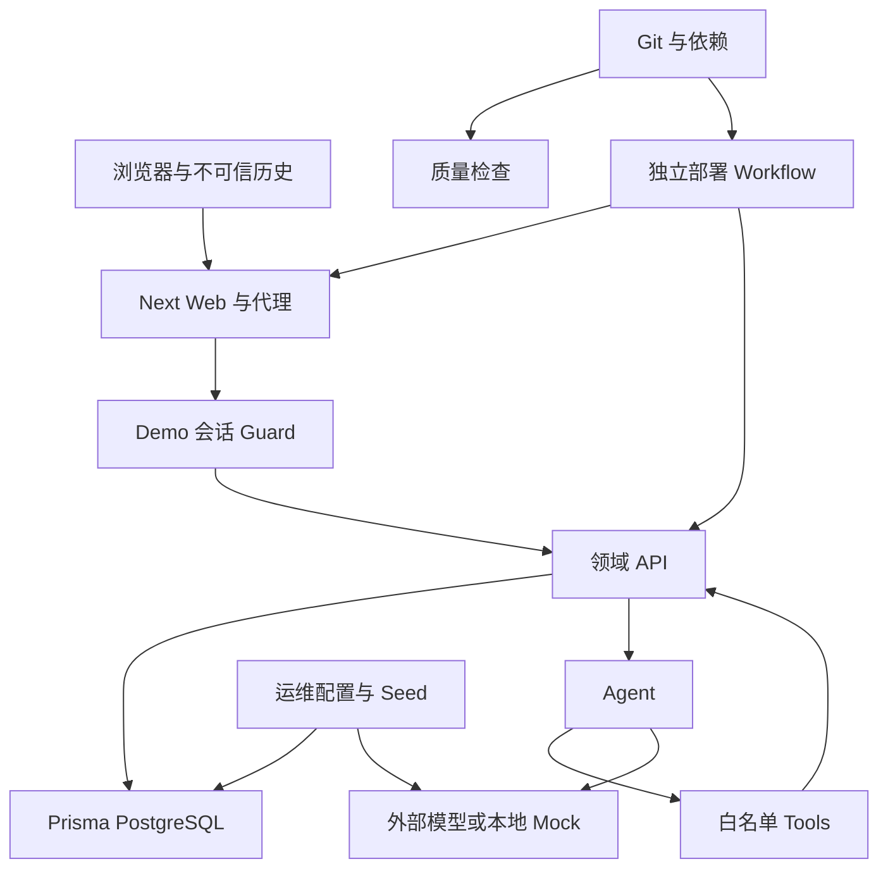

# Shopmate AI repository threat model

日期：2026-10-03。基线：`af4f96d`，分支 `feat/assistant-workspace`。状态：架构审查；未执行渗透测试，未修复源码。

## Executive summary

最需优先处理的是Demo身份与权限边界、租户关联完整性、演示写库门禁、生产部署与质量检查脱节。已有全局认证Guard、merchantId查询、严格Tool schema和Tool权限是可复用防线，但不足以支撑真实商家SaaS。当前没有真实店铺写入、消费者PII或Jev集成，所以不能把未来凭证/写操作风险当作已存在的远程漏洞。未来Action与Decision架构必须分别约束人类授权和建议性路由，不能共享执行权限。

## Scope and assumptions

- Runtime：`apps/web/src`、`apps/api/src`、`packages/contracts/src`、`packages/database/src`与Prisma migrations。
- Build / operator：`.github/workflows`、`scripts/demo-init.mjs`、seeds与配置加载。
- Tests：只作为已有覆盖证据，不等于部署保证。测试fixtures及合成商家资料不能当真实用户数据。
- 用户确认：当前仅合成经营数据，演示可能公网开放；未来真实数据默认境内部署、跨境关闭。
- 用户要求：不接真实抖店、不接真实Jev；未来Jev需单独批准与实际文档核验。
- 不在本轮验证范围：实际云主机/域名/TLS/WAF/数据库账号、已部署环境、真实供应商地域、依赖漏洞、数据库恢复、未知未来API协议。

开放问题：公网反代是否已有登录限流/Origin校验；实际DB runtime role是否具备owner/superuser；正式Identity provider选择；模型供应商地区及保留条件；实际production/staging环境；平台资质与权限。仓库没有这些证据时不宣称部署缺陷已被利用。

## System model

### Primary components

Next.js Web在`next.config.ts`把`/api`转发至API_BASE_URL；Nest由`main.ts`启动，并在`app.config.ts`配置versioning和输入验证。`auth/demo-auth.module.ts`注册APP_GUARD。PostgreSQL通过`packages/database/src/client.ts`和Prisma访问。

Analytics计算销售/库存。Monitoring API创建、运行和sync阈值规则；`monitoring.module.ts`未注册持续调度worker。`ai.module.ts`选择DeepSeek/Mock Provider、注册只读/文案/受限结构查询Tools。流式assistant是POST NDJSON，不是WebSocket，运行互斥与requestId去重是进程内状态。

CI质量workflow与main push部署workflow分开；部署SSH运行代码更新和PM2重启。Seed属于运维写库面，不是公开Runtime路由。依据：`.github/workflows/ci.yml`、`deploy.yml`、`scripts/demo-init.mjs`。

### Data flows and trust boundaries

- 浏览器 → Next / Nest：HTTP(S)、登录密码/会话Cookie/消息/过滤条件；HttpOnly+SameSite=Lax、production默认Secure、DTO与Zod。实际TLS依赖部署，未验证；repo未见全局CSRF/Origin check、登录限流、CSP配置。
- Nest → session / scope：HMAC验证与TTL，服务端建立AuthContext；顶层merchantId注入拒绝。没有server session revocation，登录授予全部现有permission。
- 服务 / Tools → PostgreSQL：Prisma查询、Decimal金额、merchantId scope；没有迁移定义RLS，部分关联缺复合tenant FK。具体role/TLS未验证。
- Agent → ToolRegistry：LLM返回工具名/args；白名单、requiredPermissions、schema input/output、调用限额。Tool handler用服务端context，不接受LLM自带tenant权限。
- Agent / ProductCopy / Monitoring generator → LLM Provider：HTTPS默认baseURL、工具数据/用户消息/商品信息；未见集中redaction/egress region enforcement。endpoint来自运维配置，不是用户输入。
- 业务来源 / client history → Agent：商品文本和历史content是可控数据；system policy声明不可信，并数字/日期校验；语义关联与脱敏仍需补足。
- 浏览器存储 → 助手历史：localStorage按身份scope保存，logout有清理；不能抵御同origin XSS或共享设备在登录期读取。
- 开发者 / 维护者 → CI → SSH部署：Git提交、build、依赖、SSH secret；质量和部署分开，不可假设所有已部署artifact均通过CI。
- 操作员 → Seed → DB：DATABASE_URL和固定命名空间；analytics Seed有dry-run和opt-in，旧seed/demo:init缺同等环境门禁。

#### Diagram

## Assets and security objectives

| Asset                                 | Why it matters                                     | Security objective (C/I/A) |
| ------------------------------------- | -------------------------------------------------- | -------------------------- |
| sessionSecret / session tokens        | 控制商家身份，签名密钥泄露可伪造scope              | C/I                        |
| 数据库与商业指标                      | 当前合成数据仍需保持演示一致性；未来是真实经营机密 | C/I/A                      |
| 商家/商品/订单关联                    | 错误tenant关联可能穿越间接查询边界                 | I/C                        |
| LLM key、endpoint、budget             | 密钥及成本；可用性和数据出站                       | C/A                        |
| 通知与Agent结论                       | 商家据此决策；幻觉与错误路由影响信任/利润          | I/A                        |
| browser history                       | 商业问题与回答本地持久化                           | C                          |
| build与SSH发布权限                    | 可修改运行代码、读取环境中的真实secret             | C/I/A                      |
| 未来platform token / approval / audit | 控制真实店铺状态与可追溯决策                       | C/I/A；当前尚未实现        |

## Attacker model

### Capabilities

公网匿名攻击者能反复请求登录及公开health；持有Demo合法session的攻击者可调用保护API并改变输入/ID。合法商家可控制商品文本/用户问题/客户端历史，尝试诱导Agent。未来恶意租户将尝试IDOR、错误scope、导出/流越权。运维误操作和有发布权限的维护者属于另一威胁来源，不能与普通远程攻击者混为一谈。

### Non-capabilities

不假设匿名攻击者能编辑环境变量、构造有效HMAC、访问DB/SSH/Vault、提交main、修改CI；没有证据说明用户可以设置Provider baseURL。当前没有真实Webhook消费者、导出、文件上传、真实Action API或Jev网络通路，不能声称已有这些攻击面。

## Entry points and attack surfaces

| Surface                         | How reached                 | Trust boundary         | Notes                                             | Evidence (repo path / symbol)                                                                         |
| ------------------------------- | --------------------------- | ---------------------- | ------------------------------------------------- | ----------------------------------------------------------------------------------------------------- |
| login / logout / me             | `/api/v1/auth`              | browser-auth           | login/logout Public，me受Guard；logout只清Cookie  | `auth/demo-auth.controller.ts`                                                                        |
| 商品列表/详情                   | `/api/v1/products`          | API-DB                 | scope查询，但Service未见products:read检查         | `products/product.controller.ts`、`product.service.ts`                                                |
| 看板分析                        | analytics controller        | API-DB                 | 旧reader只排除CANCELLED，新reader只PAID；聚合上限 | `analytics/dashboard.controller.ts`、`sales-query.repository.ts`、`ai/insights/store-sales-reader.ts` |
| 布局保存                        | dashboard-layout controller | browser-DB             | 现有user/merchant/revision保护需迁移              | `dashboard-layout/`                                                                                   |
| 监听规则、预览、执行、通知      | monitoring controller       | user-model-DB          | 昂贵请求与用户可控阈值；有schema和容量限制        | `monitoring/monitoring.controller.ts`、`monitoring.service.ts`                                        |
| chat / insights / assistant run | `/api/v1/ai`                | user-model-tools       | 请求取消/限额存在；跨进程持久预算不存在           | `ai/chat/`、`ai/insights/`                                                                            |
| health                          | Public health controller    | internet-runtime       | 不应泄露secret；实际响应测试通过不验证部署TLS     | `health/`、`test/app.e2e-spec.ts`                                                                     |
| Provider HTTP client            | server调用                  | server-egress          | 配置URL；不是已证明用户驱动SSRF                   | `config/deepseek-env.ts`、`providers/deepseek-llm.provider.ts`                                        |
| 会话历史                        | 浏览器localStorage          | client persisted data  | 有identity key与logout清理；不等于加密            | `apps/web/src/app/assistant/model.ts`、`provider.tsx`                                                 |
| 内部预警修改原型                | 未注册到当前AiModule        | latent write prototype | 有preview/confirm，但无通用审批审计               | `ai/tools/inventory-alert-update.tool.ts`、`ai.module.ts`                                             |
| Seed CLI                        | 本地/运维shell              | operator-DB            | 不统一拒绝production                              | `scripts/demo-init.mjs`、`packages/database/src/*seed.ts`                                             |
| 部署                            | main push → SSH             | repository-runtime     | 没有workflow内production approval / quality依赖   | `.github/workflows/deploy.yml`                                                                        |

## Top abuse paths

1. **会话接管**：匿名攻击者反复尝试Demo凭据 → repo登录未限流 → 登录所有现有permission；或窃取已签token → 商家退出仅清Cookie → 到期前重放仍可验证。并非假设签名破解。
2. **授权绕行**：受限合法身份被工具权限拒绝 → 直接请求商品API → 仅认证和merchant范围通过 → 获取本应禁止的同租户资源。当前固定Demo用户全权限，角色上线前必须修复统一Policy。
3. **间接跨租户关联**：seed/bug/未来导入造出跨merchant Sku→Product或OrderItem→Sku → DB只有单ID FK不拒绝 → tenant根查询include关联时可暴露异租户字段。当前未证明远程用户有构造这种记录的写入口。
4. **Agent错误结论**：攻击者在商品/历史写恶意指令或伪造业务背景 → Agent取允许Tool → 结果数字校验只确认数值存在 → 给数字归属/因果错误的建议。现有Tool permissions仍阻止未授权工具；不能由此声称当前可删除店铺商品。
5. **误出站**：操作员更改LLM endpoint/接入境外观测工具 → 真实经营/用户信息加入prompt/日志 → 无中央redaction/region门禁 → 发生非预期传输；当前合成数据影响较低，未来门禁必须补齐。
6. **Demo污染**：操作员DATABASE_URL指向真实库 → demo:init或旧seed直接upsert → 演示数据混入/撞ID归属变化 → 报表和资源完整性受损。analytics opt-in降低误操作，但不能替代production硬拒绝。
7. **未验证发布**：具有main发布权限的人提交坏代码/依赖 → 独立部署workflow不等质量检查 → SSH更新并重启 → 错误代码进入运行环境，迁移和回滚不受完整门禁约束。
8. **成本/可用性滥用**：合法Demo用户反复发chat/预览 → 单run有Tool round limits，stream有进程内互斥 → 多实例/多端点绕过统一预算 → DB原始查询/外部模型费用占用。没有必要假设无限run工具调用。

## Threat model table

| Threat ID | Threat source                                       | Prerequisites                                  | Threat action                          | Impact                             | Impacted assets                    | Existing controls (evidence)                                                                                                                | Gaps                                                      | Recommended mitigations                                                                                                                | Detection ideas                                                 | Likelihood                                           | Impact severity                               | Priority |
| --------- | --------------------------------------------------- | ---------------------------------------------- | -------------------------------------- | ---------------------------------- | ---------------------------------- | ------------------------------------------------------------------------------------------------------------------------------------------- | --------------------------------------------------------- | -------------------------------------------------------------------------------------------------------------------------------------- | --------------------------------------------------------------- | ---------------------------------------------------- | --------------------------------------------- | -------- |
| TM-001    | anonymous / token thief                             | 公网可登录，或已窃取token                      | brute force / 退出后重放               | Demo接管，未来真实身份接管         | sessions/business data             | HMAC、TTL、HttpOnly、统一错误；`demo-session.ts`、`demo-auth.service.ts`                                                                    | 未见login限流/server revocation；env直接比较密码          | 共享IP+account限流、Argon2id/IdP、吊销session/轮换、MFA-ready                                                                          | failed login、revoke后使用、device变化；不记密码/token          | medium：需有效凭据或token，但无repo限流              | medium当前合成；high未来真实                  | high     |
| TM-002    | authenticated restricted actor                      | permission受限但有同tenant session             | 绕过Tools直调未校验permission的API     | 越过resource/action权限            | 商家资源                           | 全局Guard、scope查询；`merchant-scope.guard.ts`                                                                                             | ProductService未见products:read；Demo登录全权限           | 统一Policy(subject/resource/action/tenant)，全部protected入口resource授权                                                              | permission denied计数、入口授权覆盖测试                         | medium：角色上线后路径明确；当前全权限Demo不体现分级 | medium当前；high未来                          | high     |
| TM-003    | buggy importer / operator / future malicious tenant | 有能力造成错误关联，当前非公开可见写面         | 跨tenant FK，借include读取异tenant记录 | 数据泄露/指标污染                  | DB relations                       | merchant根filter与Order-Store复合FK；`schema.prisma`                                                                                        | Sku/Product与OrderItem关联非复合scope；无RLS              | organization/store复合FK、RLS、app scoping、真实DB负例、scoped joins                                                                   | relation integrity异常、跨scope插入失败监控                     | low当前，缺远程构造入口；medium未来导入              | high真实数据泄露；medium合成                  | medium   |
| TM-004    | merchant content / malicious history / model        | 合法可控文本进入Agent                          | 注入/语义错配/伪造原因                 | 错误经营建议与提醒；未来高风险提案 | decision integrity                 | tool allowlist/permissions/schema、policy、number/date校验；`business-agent.ts`                                                             | 数值存在不证明语义与因果；诊断含商业数字                  | typed claims/evidence IDs、结构数据最小化、规则取证、动作单独审批；Decision输出不能改安全策略                                          | grounding rejects、错误事件标签、proposal-reject率；脱敏诊断    | medium：LLM行为不确定，输入可控                      | medium当前；真实execution仍需额外漏洞才变high | medium   |
| TM-005    | operator config / future provider                   | 有endpoint或供应商选择权限，真实数据进入prompt | 非预期egress/日志/本地history读取      | 商业/个人数据泄露                  | model payload、logs、history、keys | env keys、默认HTTPS、history logout清理；`deepseek-env.ts`、`assistant/provider.tsx`                                                        | URL仅protocol校验；无地区/retention/redaction policy      | 中国部署egress allowlist、TLS only prod、供应商登记、PII禁止、日志白名单、history TTL；future shadow也需授权                           | 出站域名变更、redaction/PII事件、异常Provider config            | low当前纯合成且URL运维控制；medium未来               | low当前；high未来真实PII                      | medium   |
| TM-006    | operator mistake                                    | Seed指向错误DB                                 | 演示upsert混入真实数据                 | 数据污染/ownership破坏             | DB integrity                       | analytics Seed dry-run、opt-in、namespace碰撞检查；`analytics-demo-seed.ts`                                                                 | 旧seed/demo:init无统一环境/tenant门禁；production不硬拒绝 | APP_ENV+DB marker+demo tenant+explicit flags，prod硬拒绝，scoped reset和二次确认                                                       | seed command audit、non-demo写尝试、dataset marker              | medium：多入口可误配置                               | high未来真实DB；medium当前                    | high     |
| TM-007    | maintainer / compromised dependency                 | main发布或供应链权限；非匿名普通用户           | CI未通过仍部署/不可恢复重启            | 运行完整性/可用性及secret风险      | artifacts/runtime/SSH              | frozen lock、secret scan、CI checks；`ci.yml`                                                                                               | deploy未依赖checks，staging/manual env/迁移/smoke缺失     | required checks+protected branch+依赖扫描+不可变artifact，protected production environment，staging smoke，expand migrations，恢复演练 | deployed commit CI状态、artifact digest、smoke与rollback result | medium：需维护者/供应链条件且路径可见                | high若真实生产                                | high     |
| TM-008    | authenticated abusive user                          | 能调用chat/监听preview/分析API                 | 消耗模型预算/DB/任务                   | 可用性和费用                       | LLM budget、DB/API                 | Agent3round/8calls默认、stream互斥/10min dedup、query20000上限；`business-agent.ts`、`assistant-run.controller.ts`、`store-sales-reader.ts` | 多实例限额无共享状态，非统一account预算，原始order读      | per-user/org quotas、租户并发、persistent run/idempotency、preaggregate、body/query bounds                                             | token spend、queue lag、DB load、429与tenant并发                | medium：合法session易重复请求                        | medium合成环境；high成本可能需量化            | medium   |

这些是控制缺口与攻击路径假设。未执行利用验证，不应当发布为确认的远程漏洞报告。

## Criticality calibration

- **critical**：已确认无需授权读写所有真实租户；无需人工批准执行大范围真实平台操作；远程取得生产平台凭证/运行代码。当前没有证据达到该级别。
- **high**：真实用户会话接管；真实资源授权绕过；生产数据被演示Seed覆盖或未经质量门禁发布。在当前纯合成范围，按上线阻塞项优先处理，但实际损害低于真实生产。
- **medium**：有前提的错误关联泄露；Agent错误建议但无执行通路；有合法身份的模型费用/可用性滥用；运维可配置的非预期出站。
- **low**：少量非敏感health元数据；纯合成场景局部展示错误；需要已持有全部运维权限才能造成且无额外越权的信息暴露。

评级最受影响的假设：是否接真实数据/Token、公网是否已有反代限流、运行DB权限、正式角色是否可调用当前API、CI是否有外部branch/environment保护。这里不因代码缺文件就断言云端不存在控制。

## Focus paths for security review

| Path                                                   | Why it matters                                               | Related Threat IDs     |
| ------------------------------------------------------ | ------------------------------------------------------------ | ---------------------- |
| `apps/api/src/auth/demo-auth.service.ts`               | 固定凭据与登录全权限                                         | TM-001, TM-002         |
| `apps/api/src/auth/session/demo-session.ts`            | HMAC/TTL、无revocation                                       | TM-001                 |
| `apps/api/src/auth/demo-auth.controller.ts`            | Public登录/退出、Cookie设置                                  | TM-001                 |
| `apps/api/src/auth/access/merchant-scope.guard.ts`     | 租户注入与全局身份边界                                       | TM-002, TM-003         |
| `apps/api/src/products/product.service.ts`             | API资源权限与scope                                           | TM-002                 |
| `packages/database/prisma/schema.prisma`               | FK完整性、ownership与隔离缺口                                | TM-003                 |
| `apps/api/src/ai/insights/store-sales-reader.ts`       | nested relations、限制与聚合一致性                           | TM-003, TM-008         |
| `apps/api/src/ai/tools/tool-registry.ts`               | allowlist、permission及默认requiredPermissions为空的扩展风险 | TM-002, TM-004         |
| `apps/api/src/ai/agent/business-agent.ts`              | prompt边界、数值校验、stderr诊断、限额                       | TM-004, TM-005, TM-008 |
| `apps/api/src/ai/chat/assistant-run.controller.ts`     | stream取消/身份、跨进程预算与dedup                           | TM-008                 |
| `apps/api/src/ai/tools/inventory-alert-update.tool.ts` | 未注册写原型，未来必须提案/审批分离                          | TM-004                 |
| `apps/api/src/config/deepseek-env.ts`                  | Provider URL校验，配置者可控而非公开SSRF                     | TM-005                 |
| `apps/web/src/app/assistant/provider.tsx`              | localStorage及logout清理边界                                 | TM-005                 |
| `scripts/demo-init.mjs`                                | 运维Seed入口                                                 | TM-006                 |
| `packages/database/src/seed.ts`                        | 固定ID upsert与tenant归属                                    | TM-006                 |
| `packages/database/src/analytics-demo-seed.ts`         | 当前最佳dryrun门禁但仍需production拒绝                       | TM-006                 |
| `.github/workflows/ci.yml`                             | 强制验证、真实DB门禁、依赖扫描                               | TM-007                 |
| `.github/workflows/deploy.yml`                         | main push直接发布、审批/rollback                             | TM-007                 |

## Notes on use

### 未来设计门禁（不冒充当前控制）

- DecisionProvider / future Jev：只净化结构证据；输出strict schema、低确定性弃权、Rules fallback、hard floor；shadow不改变实际行为但依然需要出站授权。风险关联TM-004/TM-005/TM-008。
- Actions：独立人类审批、scope/revision/payloadHash绑定、执行前再校验、durable幂等、timeout-before-retry回读、append audit；Provider/LLM绝不批准或执行。
- Webhooks：官方signature验证、timestamp/replay窗口、event去重及source版本；尚未有真实endpoint，算法必须先核验文档。
- Listing/import：类型/文件头/大小/行数校验、非用户文件名、隔离存储、恶意公式安全导出、解压限制和平台发布审批；当前没有上传功能。
- Exports：scope与显式permission、受控对象路径/短期签名URL、审计、授权后的PII最小化；当前尚无实现。
- Offboarding：停止采集、Connection generation撤销、worker执行前校验、token清除、purge与backup到期；审计不能记录过量个人数据。

### 验证记录

- 现有定向API：7文件89项通过（`--hookTimeout 60000 --maxWorkers 1`）；初次默认并发有2 suite hook超时，原因未做性能profile，仅调整运行限额/并发的复核通过。
- DB pure generator/constraints/migration contract：15项通过；不是真实PostgreSQL RLS/FK实测。
- 现有API隔离test使用Fixture Repository和测试签名context；它证明路由scope回归，不证明数据库关联/RLS完整隔离。
- `core-scenarios.e2e-spec.ts`、`dashboard-layout.database.e2e-spec.ts`、`j4-live-agent.e2e-spec.ts`有环境开关，普通test可能跳过DB/live；CI无DB service可见配置。
- 无源码修复、无新增测试、无真实LLM/平台请求、无渗透测试或部署检查；未读取或输出真实.env/凭证。

### Quality check

- [x] 已发现的auth、products、analytics、layout、monitoring、AI/stream、health入口覆盖。
- [x] browser-auth、API-DB、Agent-tools、model-egress、local history、operator DB、CI/deploy边界均至少对应一项威胁。
- [x] Runtime、潜在未来接口、CI/运维与fixtures区分。
- [x] 采用用户已确认的Mock/公网/境内/跨境边界。
- [x] 现有控制与目标控制分开，未确认部署细节和攻击前提明确。

本报告作为后续实施和人工安全复核入口，与 [架构审查](2026-10-03-production-mock-review.md) 及 [DecisionProvider设计](2026-10-03-decision-provider-design.md) 一起评审。Suggested commit：`docs(security): document repository threats and release gates`。
